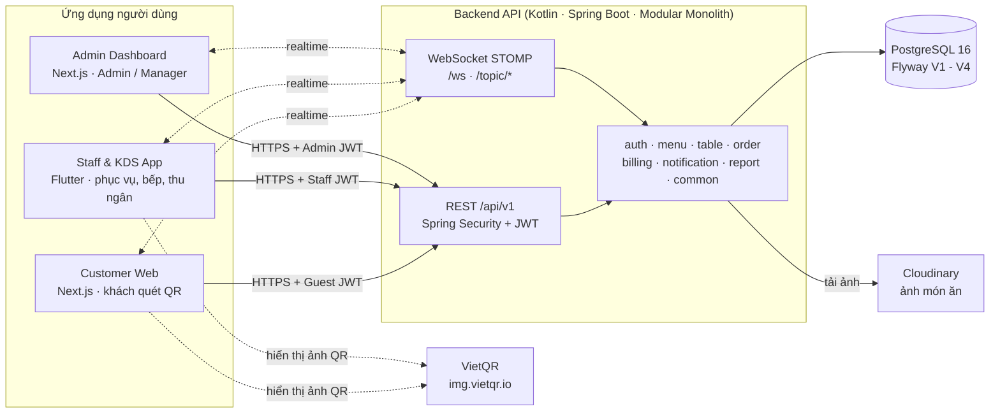
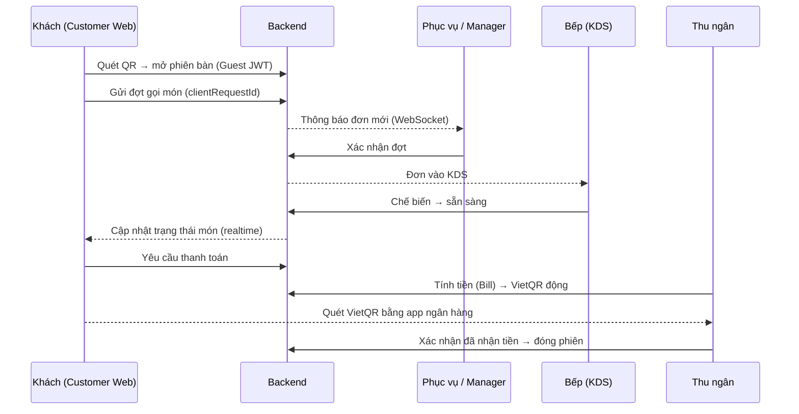

# QR Order - Hệ thống đặt món tại bàn qua mã QR

> Khách quét QR tại bàn → xem thực đơn → gọi món → bếp, thu ngân, quản lý nhận và xử lý **thời gian thực** → thanh toán bằng **VietQR động**. Một hệ thống trọn bộ gồm 4 thành phần: Customer Web, Staff & KDS App, Admin Dashboard và Backend API.


---

## 1. Tổng quan và giá trị nghiệp vụ

**Bài toán:** nhà hàng thường mất thời gian ở 3 khâu: khách chờ nhân viên đến ghi món, đơn truyền miệng từ phục vụ sang bếp dễ sai sót, và thu ngân tính tiền thủ công. QR Order số hóa toàn bộ chuỗi này mà vẫn giữ quyền kiểm soát của nhân viên.

| Giá trị | Cách hệ thống đạt được |
| :--- | :--- |
| **Gọi món không cần chờ** | Khách quét mã QR dán trên bàn bằng điện thoại, không cần cài app hay đăng ký tài khoản. Phiên bàn (Table Session) được mở khi quét; có thể bật mã PIN bàn để chống gọi món từ xa. |
| **Đồng bộ thời gian thực** | Đơn mới, xác nhận đơn, tiến độ bếp (đang chế biến → sẵn sàng), gọi nhân viên, đổi trạng thái hết món... được đẩy qua WebSocket (STOMP) tới khách, phục vụ, bếp và quản lý ngay lập tức. |
| **Bếp làm việc trên màn hình KDS** | Đơn được chia theo đợt gọi món; bếp nhận, chế biến và báo hoàn thành; phục vụ biết món nào sẵn sàng để mang ra bàn. |
| **Thanh toán nhanh, ít sai** | Thu ngân tính tiền (giảm giá, VAT, phí phục vụ), hệ thống sinh **VietQR động** đúng số tiền và nội dung hóa đơn để khách quét bằng app ngân hàng; thu ngân xác nhận đã nhận tiền, hỗ trợ thu một phần và nhiều phương thức. |
| **Kiểm soát và minh bạch** | Phân quyền theo vai trò, nhật ký kiểm toán (audit log), hủy món theo quy trình (khách yêu cầu → Manager duyệt), Void/hoàn tiền có biên lai, báo cáo doanh thu và hiệu suất phục vụ. |

**Vai trò sử dụng:** Khách (Guest Session) · Phục vụ (Staff) · Bếp (Kitchen) · Thu ngân (quyền thanh toán) · Quản lý (Manager) · Quản trị (Admin).

---

## 2. Kiến trúc hệ thống



**Luồng chính (rút gọn):**



---

## 3. Điểm nhấn kỹ thuật và an toàn dữ liệu

- **Modular Monolith** theo Layered Architecture (Controller → Service → Repository → Entity/DTO), tách module `auth`, `menu`, `table`, `order`, `billing`, `notification`, `report`, `common`. Dễ tách service khi cần mà không trả giá vận hành của microservices.
- **Idempotency:** mọi thao tác tạo đơn/thanh toán/hoàn tiền mang `clientRequestId` / `requestId`; gửi lặp do mạng chập chờn trả lại kết quả cũ thay vì tạo trùng.
- **Khóa và đồng thời:** *pessimistic locking* khi tính tiền (khóa bàn → phiên → đơn) và *optimistic locking* bằng cột `version` ở dữ liệu cấu hình/đơn; xung đột trả `409 CONCURRENT_MODIFICATION` để client tải lại.
- **Máy trạng thái chặt chẽ ngay tại DB:** vòng đời đơn (đợt, món), hóa đơn (Bill) và phiên bàn được ràng buộc bằng trigger và `CHECK` của PostgreSQL, nên dữ liệu sai không thể lọt vào ngay cả khi có lỗi ở tầng ứng dụng. Các trạng thái tài chính đặc biệt: `VOID_PENDING`, `WRITTEN_OFF`, biên lai hoàn tiền `RF-YYYYMMDD-NNNN`, hóa đơn `BILL-YYYYMMDD-NNNN`.
- **RBAC với quyền động:** vai trò ADMIN / MANAGER / STAFF / KITCHEN cộng quyền chi tiết theo người dùng (ví dụ `PAYMENT_PROCESS`, `SESSION_FORCE_CLOSE`); Manager mặc định có quyền nghiệp vụ, các vai trò khác cấp theo permission, mọi thay đổi vai trò/quyền đều xác thực lại mật khẩu và ghi audit log.
- **Guest Session an toàn:** token QR có chữ ký, JWT khách gắn với phiên bàn và kiểm tra phiên còn mở ở cả REST lẫn WebSocket; gia hạn token tuần tự một luồng (single-flight) để không đua nhau; PIN bàn và giới hạn tần suất (`429` + `Retry-After`).
- **VietQR động, thu ngân xác nhận tay:** backend dựng sẵn URL ảnh QR (số tài khoản nhận tiền cấu hình trong Admin, lưu ở DB); nội dung chuyển khoản là số hóa đơn; không phụ thuộc cổng thanh toán trung gian.
- **Migration có kiểm soát:** Flyway V1 → V4, Hibernate `validate` (không `ddl-auto`), tách dữ liệu seed dev khỏi production.
- **Kiểm thử tự động và CI:**

| Thành phần | Kiểm thử | CI (GitHub Actions) |
| :--- | :--- | :--- |
| Backend | 484 test (unit + integration với Testcontainers/PostgreSQL thật), 191 case schema SQL | `backend-ci` |
| Customer Web | 66 test Vitest | `customer-web-ci` |
| Admin Dashboard | 52 test Vitest | `admin-dashboard-ci` |
| Staff App | Bộ test Flutter (`flutter test`) và `flutter analyze` sạch | chạy cục bộ |

  Cả 3 workflow CI đều xanh. Các số liệu test lấy từ lần chạy gần nhất của tác giả và có thể tăng khi dự án phát triển tiếp.

---

## 4. Cấu trúc thư mục và công nghệ

```text
qr-order/
├── qr-order-backend/     # Backend API (Kotlin, Spring Boot)
├── customer-web/         # Web cho khách quét QR (Next.js)
├── admin-dashboard/      # Trang quản trị (Next.js)
├── staff_app/            # Ứng dụng nhân viên & bếp KDS (Flutter)
├── docs/                 # SRS, thiết kế CSDL, lưu trữ tiến độ
├── .github/workflows/    # CI: backend-ci, admin-dashboard-ci, customer-web-ci
├── docker-compose.yml    # PostgreSQL 16 + Backend
├── .env.example          # Mẫu biến môi trường cho Docker Compose
└── PROJECT_PROGRESS.md   # Nhật ký tiến độ duy nhất của dự án
```

| Thành phần | Công nghệ |
| :--- | :--- |
| **Backend API** | Kotlin 1.9, Spring Boot 3.5, Java 21, Spring Security + JWT, Spring Data JPA, WebSocket (STOMP/SockJS), Flyway, SpringDoc OpenAPI, Testcontainers |
| **Cơ sở dữ liệu** | PostgreSQL 16 |
| **Customer Web** | Next.js 16, React 19, TypeScript (strict), Tailwind CSS 4, Axios, TanStack Query 5, Zustand 5, `@stomp/stompjs`, Vitest |
| **Admin Dashboard** | Next.js 16, React 19, TypeScript (strict), Tailwind CSS 4, Axios, TanStack Query 5, Zustand 5, `@stomp/stompjs`, Recharts, Vitest |
| **Staff & KDS App** | Flutter (≥ 3.24), Dart (≥ 3.5), Riverpod, GoRouter, Dio, `stomp_dart_client`, `flutter_secure_storage` |
| **Hạ tầng** | Docker / Docker Compose, GitHub Actions, Cloudinary (ảnh món), VietQR (ảnh QR thanh toán) |

Chi tiết thiết kế: [`docs/DATABASE_DESIGN.md`](docs/DATABASE_DESIGN.md) · tài liệu SRS trong [`docs/`](docs/) · README riêng của từng thành phần: [`qr-order-backend/README.md`](qr-order-backend/README.md), `customer-web/README.md`, `admin-dashboard/README.md`.

---

## 5. Quick Start

**Yêu cầu:** Docker Desktop (đang chạy), Node.js 20+, Flutter SDK (chỉ khi chạy Staff App), JDK 21 (chỉ khi chạy/test backend ngoài Docker).

### 5.1. Backend + PostgreSQL

```bash
git clone <URL-repository-của-bạn> qr-order
cd qr-order

# 1) Tạo file cấu hình
cp .env.example .env          # Windows PowerShell: Copy-Item .env.example .env
```

Mở `.env` và điền tối thiểu các biến sau (không commit file `.env`):

```dotenv
DB_PASSWORD=<mật-khẩu-DB-của-bạn>
JWT_SECRET=<chuỗi Base64 >= 32 byte, tạo bằng: openssl rand -base64 48>
QR_TOKEN_SECRET=<chuỗi Base64 >= 32 byte, tạo bằng: openssl rand -base64 48>

# Tài khoản ADMIN đầu tiên (tạo tự động ở lần khởi động đầu)
INITIAL_ADMIN_USERNAME=admin
INITIAL_ADMIN_PASSWORD=<tối thiểu 8 ký tự, có chữ hoa, chữ thường, chữ số>
INITIAL_ADMIN_FULL_NAME=Quản trị viên

# Origin của các giao diện web (thêm http://<IP-máy>:3000 nếu thử bằng điện thoại qua LAN)
CORS_ALLOWED_ORIGINS=http://localhost:3000,http://localhost:3001
WS_ALLOWED_ORIGINS=http://localhost:3000,http://localhost:3001
```

```bash
# 2) Khởi động PostgreSQL 16 + Backend (profile dev, tự chạy Flyway V1 → V4 + dữ liệu mẫu)
docker compose up -d --build

# Kiểm tra: Swagger UI (profile dev) http://localhost:8080/swagger-ui.html
```

> Mặc định backend ở cổng `8080` (đổi bằng `SERVER_PORT`), PostgreSQL map ra cổng máy `5433`.

### 5.2. Customer Web (cổng 3000)

```bash
cd customer-web
cp .env.example .env.local     # NEXT_PUBLIC_API_URL, NEXT_PUBLIC_WS_URL trỏ về backend
npm ci
npm run dev
```

Thử ngay với bàn mẫu (profile dev): mở **http://localhost:3000/t/dev-qr-T01** (QR dev của bàn T01).

### 5.3. Admin Dashboard (cổng 3001)

```bash
cd admin-dashboard
cp .env.example .env.local
npm ci
npm run dev
```

Mở **http://localhost:3001**, đăng nhập bằng tài khoản `INITIAL_ADMIN_*` ở trên. Tại đây tạo tài khoản Manager / Staff / Bếp, cấu hình VAT, tài khoản nhận tiền VietQR (BIN ngân hàng, số tài khoản, tên chủ tài khoản), quản lý thực đơn, bàn và mã QR.

### 5.4. Staff & KDS App (Flutter)

```bash
cd staff_app
flutter pub get
# Android emulator (backend chạy trên máy chủ):
flutter run --dart-define=API_BASE_URL=http://10.0.2.2:8080
# Thiết bị thật: dùng IP LAN của máy chạy backend, ví dụ http://192.168.1.10:8080
```

Đăng nhập bằng tài khoản Manager / Staff / Bếp đã tạo ở Admin Dashboard. Địa chỉ máy chủ cũng có thể đổi trong màn hình cài đặt máy chủ của app.

### 5.5. Dữ liệu mẫu để thử ngay

| Thứ cần thử | Giá trị |
| :--- | :--- |
| Dữ liệu seed (profile `dev`) | 11 bàn, thực đơn mẫu, VAT 8% |
| Liên kết QR bàn T01 | `http://localhost:3000/t/dev-qr-T01` |
| Tài khoản ADMIN | Theo `INITIAL_ADMIN_USERNAME` / `INITIAL_ADMIN_PASSWORD` trong `.env` của bạn |
| Tài khoản Manager / Staff / Bếp | Hệ thống **không có sẵn**, tạo ở Admin Dashboard → Nhân sự |

**Kịch bản thử nhanh 5 phút:** (1) Admin tạo Manager và Staff, cấu hình tài khoản ngân hàng → (2) mở Customer Web ở bàn T01 và gọi vài món → (3) trên Staff App xác nhận đợt, bếp chuyển món sang sẵn sàng → (4) khách bấm yêu cầu thanh toán → (5) thu ngân tính tiền, quét thử VietQR bằng app ngân hàng, xác nhận đã nhận tiền và đóng phiên.

### 5.6. Chạy kiểm thử

```bash
# Backend (cần Docker đang chạy vì dùng Testcontainers)
cd qr-order-backend && ./gradlew build        # Windows: .\gradlew.bat build

# Customer Web / Admin Dashboard
cd customer-web && npm ci && npm run lint && npm run typecheck && npm test
cd admin-dashboard && npm ci && npm run lint && npm run typecheck && npm test

# Staff App
cd staff_app && flutter analyze && flutter test
```

> **Bảo mật:** không đưa `.env`, `JWT_SECRET`, `QR_TOKEN_SECRET`, mật khẩu hay khóa Cloudinary vào Git. Sau lần đăng nhập đầu tiên, nên xóa `INITIAL_ADMIN_PASSWORD` khỏi `.env`. Khi triển khai thật, dùng profile production (chỉ chạy migration V1 → V3 → V4, không có dữ liệu seed) và tắt OpenAPI (`OPENAPI_ENABLED=false`).

---

## 6. Ảnh minh họa

> Chụp màn hình và lưu vào `docs/screenshots/` với đúng tên file bên dưới; bảng sẽ tự hiển thị ảnh.

| Customer Web (khách gọi món) | Staff App (phục vụ, thu ngân) |
| :---: | :---: |
|  |  |
| *Thực đơn, giỏ hàng, theo dõi trạng thái món, VietQR* | *Sơ đồ bàn, duyệt đợt, thu tiền VietQR* |

| Kitchen Display - KDS (bếp) | Admin Dashboard (quản trị) |
| :---: | :---: |
|  |  |
| *Hàng đợi món theo đợt, đổi trạng thái chế biến* | *Báo cáo doanh thu, thực đơn, bàn và QR, nhân sự* |

---

## 7. Trạng thái dự án

Backend (GĐ0 - GĐ6), Customer Web, Admin Dashboard, Staff App và VietQR đều đã hoàn thành và được kiểm thử thực tế (gồm cả thử trên điện thoại thật qua mạng LAN). Tiến độ chi tiết và lịch sử quyết định: [`PROJECT_PROGRESS.md`](PROJECT_PROGRESS.md).

**Hướng phát triển tiếp (chưa làm):** hardening và giám sát vận hành, xem trước QR ở Admin, đối soát chuyển khoản tự động, component test cho giao diện web.

---

*Dự án học tập và portfolio. Chưa kèm giấy phép (license) mở; hãy thêm tệp `LICENSE` nếu muốn công khai tái sử dụng.*
