# QR Order - Thiết kế cơ sở dữ liệu (PROMPT 02)

Phiên bản 1.1 | 19/11/2026 (1.1: thêm V3 theo xác nhận DB-01..DB-04) | PostgreSQL 16 | Flyway
Nguồn nghiệp vụ: `Hệ thống QR Order - SRS & Thiết kế (v0.3)` (§0.1, §0.2, §8, §9.1-9.10, §10, §11.5, §11.6).
Migration: `db/migration/V1__init_schema.sql`, `db/migration/V3__add_refresh_token_and_item_history.sql` (mọi môi trường), `db/seed-dev/V2__seed_dev.sql` (chỉ dev).
Kiểm thử: `tests/run_all.sh` + `tests/test_schema.py` (181 case + 1 kiểm tra backfill, PASS trên PostgreSQL 16.15; xem mục 9).

## 1. Tổng quan và quy ước

26 bảng: 24 bảng theo ERD định hướng §11.5 (V1) và 2 bảng bổ sung đã được người dùng duyệt (V3): `refresh_token` (DB-01) và `order_item_status_history` (DB-02). Không đổi tên bảng hay trạng thái so với SRS; không có bảng `roles`/`user_roles`, không có `branch_id`.

| Hạng mục | Quy ước | Lý do |
| --- | --- | --- |
| Khóa chính | `BIGINT GENERATED BY DEFAULT AS IDENTITY` | Đơn giản với JPA; `BY DEFAULT` cho phép seed/test chèn id khi cần |
| Tiền | `BIGINT`, đơn vị VND, `CHECK >= 0` (giao dịch `> 0`) | DEC-14, NFR-05 |
| Tỷ lệ | `NUMERIC(5,4)` dạng thập phân (0.0800 = 8%), `0 <= r < 1` | BR-P03; không lỗi số thực |
| Thời gian | `TIMESTAMPTZ`; ngày nghiệp vụ tính theo `Asia/Ho_Chi_Minh` | BR-P01 |
| Enum | `VARCHAR + CHECK` (không dùng kiểu ENUM của PostgreSQL) | Map trực tiếp `@Enumerated(EnumType.STRING)`; thêm giá trị chỉ cần sửa CHECK |
| Optimistic lock | `version BIGINT NOT NULL DEFAULT 0` | NFR-05. Có ở 8 bảng bắt buộc (`dining_table`, `table_session`, `orders`, `order_batch`, `order_item`, `bill`, `service_call`, `item_cancel_request`) và thêm ở `users`, `restaurant_settings`, `category`, `product`, `option_group`, `option_item` |
| Không xóa cứng | Trigger `fn_forbid_delete` trên 20 bảng nghiệp vụ; `audit_log`, `transaction_status_history`, `order_item_option`, `order_item_status_history` chỉ thêm. `refresh_token` không phải dữ liệu nghiệp vụ: Scheduler được xóa theo cả family | BR-A03 |
| Đặt tên | `pk_`, `fk_`, `uq_`, `ck_` cho constraint; `ux_` unique index, `ix_` index | Lỗi vi phạm trả về tên ràng buộc, backend map sang mã lỗi API |
| Lỗi từ trigger | `SQLSTATE P0001`, thông điệp bắt đầu bằng mã máy đọc được, ví dụ `PAYMENT_EXCEEDS_REMAINING:` | Backend map sang HTTP 409/422 |

Bảng nối và khóa kép đáng chú ý:

- `order_batch (order_id, session_id)` tham chiếu `orders (id, session_id)`: `session_id` được lưu lại ở đợt để có `UNIQUE (session_id, client_request_id)` đúng như BR-O04, và FK kép bảo đảm không lệch phiên.
- `order_item (batch_id, order_id)` tham chiếu `order_batch (id, order_id)`: `order_id` lưu ở dòng món để tính Subtotal nhanh, FK kép bảo đảm khớp đợt.
- `bill (replaces_bill_id, order_id)` tham chiếu `bill (id, order_id)`: Bill thay thế chỉ thay Bill của cùng Order (BR-P16).

## 2. ERD

Sơ đồ đã được kiểm tra cú pháp bằng trình phân tích Mermaid 11. Để dễ đọc, sơ đồ chỉ vẽ FK cấu trúc; các FK tới `users` dạng "người thực hiện" (`created_by`, `decided_by`, `confirmed_by`...) liệt kê đầy đủ ở mục 4.4.

```mermaid
erDiagram
    restaurant_settings {
        smallint id PK "luôn = 1"
        numeric vat_rate "NULL = chưa cấu hình"
        numeric service_fee_rate
        boolean service_fee_taxable "NULL (P-5)"
        varchar order_confirmation_mode
    }
    daily_sequence {
        varchar sequence_type PK "BILL | PAYMENT_RECEIPT | REFUND_RECEIPT"
        date business_date PK "Asia/Ho_Chi_Minh"
        int last_value
    }
    users {
        bigint id PK
        varchar username UK
        varchar role "ADMIN | MANAGER | STAFF | KITCHEN"
        varchar status "ACTIVE | LOCKED | DISABLED"
    }
    user_permission {
        bigint id PK
        bigint user_id FK
        varchar permission "8 permission chuẩn"
        bigint granted_by FK
        timestamptz revoked_at "NULL = còn hiệu lực"
    }
    audit_log {
        bigint id PK
        bigint actor_user_id FK
        varchar action
        varchar entity_type
        bigint entity_id
        jsonb old_value
        jsonb new_value
        boolean reauthenticated
    }
    category {
        bigint id PK
        varchar name UK
        boolean is_visible
    }
    product {
        bigint id PK
        bigint category_id FK
        bigint price "VND, đã gồm VAT"
        varchar status "AVAILABLE | SOLD_OUT | HIDDEN"
        varchar image_url "Cloudinary"
    }
    option_group {
        bigint id PK
        varchar selection_type "SINGLE | MULTIPLE"
        boolean is_required
        smallint min_select
        smallint max_select
    }
    option_item {
        bigint id PK
        bigint option_group_id FK
        bigint extra_price
    }
    product_option_group {
        bigint product_id PK, FK
        bigint option_group_id PK, FK
    }
    dining_table {
        bigint id PK
        varchar code UK
        varchar status "AVAILABLE | OCCUPIED | PAYMENT_PENDING | CLEANING"
        boolean is_active
    }
    qr_code {
        bigint id PK
        bigint table_id FK
        char token_hash UK "SHA-256 hex"
        varchar status "ACTIVE | ROTATED | REVOKED"
    }
    table_session {
        bigint id PK
        bigint table_id FK
        varchar status "OPEN | BILLING | CLOSED | EXPIRED | FORCE_CLOSED"
        boolean needs_attention
        timestamptz verified_at
        char table_pin
    }
    session_device {
        bigint id PK
        bigint session_id FK
        varchar device_id
    }
    service_call {
        bigint id PK
        bigint session_id FK
        varchar type "CALL_STAFF | REQUEST_PAYMENT | MANAGER_SUPPORT"
        varchar status "OPEN | ACKNOWLEDGED | RESOLVED"
    }
    orders {
        bigint id PK
        bigint session_id FK, UK "1-1 với phiên"
        varchar status "OPEN | LOCKED | PAID | VOIDED | WRITTEN_OFF"
        varchar status_before_void
        boolean needs_attention
        bigint shortfall_amount "thất thu"
    }
    order_batch {
        bigint id PK
        bigint order_id FK
        bigint session_id FK
        int seq
        uuid client_request_id "UK cùng session_id"
        varchar status
        bigint claimed_by FK
        timestamptz claimed_at
    }
    order_item {
        bigint id PK
        bigint order_id FK
        bigint batch_id FK
        bigint product_id FK
        varchar product_name "snapshot"
        bigint unit_price "snapshot"
        int quantity
        bigint line_total
        varchar status
        varchar reason_code
        boolean wasted
    }
    order_item_option {
        bigint id PK
        bigint order_item_id FK
        bigint option_item_id FK
        varchar option_name "snapshot"
        bigint extra_price "snapshot"
    }
    item_cancel_request {
        bigint id PK
        bigint order_item_id FK
        varchar status "PENDING | APPROVED | DENIED"
        bigint decided_by FK
    }
    bill {
        bigint id PK
        bigint order_id FK
        varchar bill_number UK "BILL-YYYYMMDD-NNNN"
        varchar status "ACTIVE | VOID_PENDING | VOIDED | WRITTEN_OFF"
        varchar payment_status "UNPAID | PARTIALLY_PAID | PAID"
        bigint total_amount
        numeric vat_rate "snapshot"
        bigint replaces_bill_id FK
    }
    payment_transaction {
        bigint id PK
        bigint bill_id FK
        uuid request_id UK
        varchar receipt_number UK "YYYYMMDD-NNNN khi SUCCESS"
        varchar method
        bigint amount
        varchar status "PENDING | SUCCESS | FAILED"
        varchar provider
    }
    refund_transaction {
        bigint id PK
        bigint bill_id FK
        uuid request_id UK
        varchar receipt_number UK "RF-YYYYMMDD-NNNN khi SUCCESS"
        bigint amount
        varchar status "PENDING | SUCCESS | FAILED"
    }
    refresh_token {
        bigint id PK
        bigint user_id FK
        uuid family_id "chuỗi rotation"
        char token_hash UK "SHA-256 hex"
        timestamptz expires_at
        timestamptz revoked_at "NULL = còn hiệu lực"
        varchar revoke_reason
        bigint replaced_by_id FK
    }
    order_item_status_history {
        bigint id PK
        bigint order_item_id FK
        varchar from_status
        varchar to_status
        varchar changed_by_type "GUEST | STAFF | SYSTEM"
        bigint changed_by_user_id FK
        varchar reason_code
    }
    transaction_status_history {
        bigint id PK
        bigint payment_transaction_id FK
        bigint refund_transaction_id FK
        varchar from_status
        varchar to_status
    }

    users ||--o{ user_permission : "được cấp"
    users ||--o{ audit_log : "thực hiện"
    category ||--o{ product : "chứa"
    product ||--o{ product_option_group : "N-N"
    option_group ||--o{ product_option_group : "N-N"
    option_group ||--|{ option_item : "gồm"
    dining_table ||--o{ qr_code : "có (tối đa 1 ACTIVE)"
    dining_table ||--o{ table_session : "có (tối đa 1 OPEN/BILLING)"
    table_session ||--|{ session_device : "nhiều thiết bị"
    table_session ||--o| orders : "1-1"
    table_session ||--o{ service_call : "gọi hỗ trợ"
    orders ||--|{ order_batch : "theo đợt"
    order_batch ||--|{ order_item : "gồm"
    product ||--o{ order_item : "tham chiếu"
    order_item ||--o{ order_item_option : "snapshot option"
    option_item ||--o{ order_item_option : "tham chiếu"
    order_item ||--o{ item_cancel_request : "yêu cầu hủy"
    orders ||--o{ bill : "tối đa 1 ACTIVE/VOID_PENDING"
    bill |o--o{ bill : "Bill thay thế"
    bill ||--o{ payment_transaction : "thu tiền"
    bill ||--o{ refund_transaction : "hoàn tiền"
    payment_transaction ||--o{ transaction_status_history : "lịch sử"
    refund_transaction ||--o{ transaction_status_history : "lịch sử"
    users ||--o{ refresh_token : "đăng nhập"
    refresh_token |o--o| refresh_token : "rotation"
    order_item ||--|{ order_item_status_history : "lịch sử trạng thái"
```



| Quan hệ | Bản số | Thực thi bằng |
| --- | --- | --- |
| `table_session` - `orders` | 1-1 (Order tạo khi có đợt đầu) | `uq_orders_session` |
| `orders` - `bill` | 1-N, tối đa 1 Bill ACTIVE/VOID_PENDING | `ux_bill_current_per_order` (partial) |
| `dining_table` - `table_session` | 1-N, tối đa 1 phiên OPEN/BILLING | `ux_table_session_active_per_table` (partial) |
| `dining_table` - `qr_code` | 1-N, tối đa 1 QR ACTIVE | `ux_qr_code_active_per_table` (partial) |
| `product` - `option_group` | N-N | bảng nối `product_option_group` |
| `orders` - `order_batch` - `order_item` - `order_item_option` | 1-N - 1-N - 1-N | FK kép |
| `bill` - `payment_transaction` / `refund_transaction` | 1-N mỗi loại | FK, trigger giới hạn tiền |
| `payment_transaction` / `refund_transaction` - `transaction_status_history` | 1-N | FK, trigger tự ghi |
| `bill` - `bill` | Bill thay thế trỏ Bill bị thay | FK kép cùng `order_id` |
| `users` - `user_permission` | 1-N, tối đa 1 bản cấp hiệu lực mỗi permission | `ux_user_permission_active` (partial) |
| `table_session` - `service_call` | 1-N, tối đa 1 yêu cầu mở mỗi loại | `ux_service_call_open_per_type` (partial) |
| `users` - `refresh_token` | 1-N; mỗi family tối đa 1 token chưa thu hồi | `ux_refresh_token_family_active` (partial) |
| `refresh_token` - `refresh_token` | Token cũ trỏ đúng 1 token kế tiếp cùng family/user | `uq_refresh_token_replaced_by`, FK kép `fk_refresh_token_replaced_by` |
| `order_item` - `order_item_status_history` | 1-N (ít nhất 1 dòng từ lúc tạo món) | FK, trigger tự ghi |


## 3. Đặc tả chi tiết từng bảng

Ký hiệu cột Ràng buộc: PK khóa chính, FK khóa ngoại (bảng tham chiếu), UQ unique. CHECK và partial unique index liệt kê đầy đủ ở mục 4. Nội dung mục này sinh tự động (`tools/gen_doc.py`) từ catalog PostgreSQL sau khi chạy V1 và V3, nên khớp với SQL.

### Hệ thống, cấu hình & audit

#### 3.1 `restaurant_settings`

Cấu hình nghiệp vụ, đúng 1 dòng (id = 1). Mọi tham số BR-C01. Đổi cấu hình phải ghi audit_log (BR-A05).

| Cột | Kiểu | Null | Default | Ràng buộc | Ý nghĩa nghiệp vụ |
| --- | --- | --- | --- | --- | --- |
| `id` | smallint | NOT NULL | 1 | PK | Luôn = 1 (đúng một dòng) |
| `timezone` | character varying(64) | NOT NULL | 'Asia/Ho_Chi_Minh'::character varying |  | Múi giờ tính ngày của mã chứng từ (BR-P01) |
| `money_rounding_mode` | character varying(16) | NOT NULL | 'HALF_UP'::character varying |  | Quy tắc làm tròn tiền (O2) |
| `vat_rate` | numeric(5,4) | NULL |  |  | Thuế suất VAT dạng thập phân; NULL = chưa cấu hình, chặn tạo Bill (BR-P03) |
| `prices_include_vat` | boolean | NOT NULL | true |  | Giá menu đã gồm VAT (DEC-10 A) |
| `service_fee_rate` | numeric(5,4) | NOT NULL | 0 |  | Tỷ lệ phí phục vụ, mặc định 0 (A1) |
| `service_fee_taxable` | boolean | NULL |  |  | Phí phục vụ có chịu VAT không; NULL = chưa chốt (P-5, BR-P04) |
| `session_idle_timeout_minutes` | integer | NOT NULL | 180 |  | Idle timeout của phiên (3 giờ) |
| `guest_jwt_ttl_minutes` | integer | NOT NULL | 15 |  | TTL Guest JWT (15 phút) |
| `batch_claim_ttl_seconds` | integer | NOT NULL | 60 |  | TTL claim đợt order (60 giây, BR-O10) |
| `max_pending_batches_per_session` | integer | NOT NULL | 3 |  | Số đợt PENDING tối đa mỗi phiên (BR-S09) |
| `join_rate_limit_per_minute` | integer | NOT NULL | 10 |  | Rate limit join/phút/IP (BR-S09) |
| `order_rate_limit_per_minute` | integer | NOT NULL | 5 |  | Rate limit gửi order/phút/phiên (BR-S09) |
| `max_item_quantity` | integer | NOT NULL | 99 |  | Số lượng tối đa mỗi dòng món (BR-O03; mặc định 99, người dùng xác nhận DB-03) |
| `order_confirmation_mode` | character varying(20) | NOT NULL | 'FIRST_BATCH_ONLY'::character varying |  | FIRST_BATCH_ONLY \| ALL \| NONE (BR-S04) |
| `require_table_pin` | boolean | NOT NULL | false |  | Bật PIN bàn 4 số (DEC-07 A) |
| `cleaning_auto_release` | boolean | NOT NULL | false |  | CLEANING tự về AVAILABLE (DEC-04 B) |
| `updated_by` | bigint | NULL |  | FK → users | Người đổi cấu hình gần nhất (đổi cấu hình phải audit) |
| `updated_at` | timestamp with time zone | NOT NULL | now() |  | Thời điểm cập nhật gần nhất (ứng dụng đặt) |
| `version` | bigint | NOT NULL | 0 |  | Optimistic lock (@Version, NFR-05) |

#### 3.2 `daily_sequence`

Ba dãy số riêng, đánh lại từ 1 mỗi ngày theo Asia/Ho_Chi_Minh, không tái sử dụng (BR-P12). Cấp số qua fn_next_document_number().

| Cột | Kiểu | Null | Default | Ràng buộc | Ý nghĩa nghiệp vụ |
| --- | --- | --- | --- | --- | --- |
| `sequence_type` | character varying(20) | NOT NULL |  | PK | BILL \| PAYMENT_RECEIPT \| REFUND_RECEIPT |
| `business_date` | date | NOT NULL |  | PK | Ngày theo Asia/Ho_Chi_Minh |
| `last_value` | integer | NOT NULL |  |  | Số đã cấp gần nhất trong ngày (1..9999) |
| `updated_at` | timestamp with time zone | NOT NULL | now() |  | Thời điểm cập nhật gần nhất (ứng dụng đặt) |

#### 3.3 `audit_log`

Nhật ký thao tác nhạy cảm, bất biến, chỉ thêm (BR-A05). Danh mục action xem DATABASE_DESIGN.md.

| Cột | Kiểu | Null | Default | Ràng buộc | Ý nghĩa nghiệp vụ |
| --- | --- | --- | --- | --- | --- |
| `id` | bigint | NOT NULL | identity | PK | Khóa chính (identity) |
| `occurred_at` | timestamp with time zone | NOT NULL | now() |  | Thời điểm xảy ra |
| `actor_type` | character varying(8) | NOT NULL |  |  | USER \| GUEST \| SYSTEM |
| `actor_user_id` | bigint | NULL |  | FK → users | Người thực hiện (khi actor_type = USER) |
| `action` | character varying(64) | NOT NULL |  |  | Mã hành động, xem danh mục mục 6 |
| `entity_type` | character varying(64) | NOT NULL |  |  | Tên bảng của đối tượng |
| `entity_id` | bigint | NULL |  |  | Id đối tượng |
| `old_value` | jsonb | NULL |  |  | Giá trị cũ (JSON, ví dụ role cũ) |
| `new_value` | jsonb | NULL |  |  | Giá trị mới (JSON) |
| `reason` | text | NULL |  |  | Lý do (bắt buộc với các hành động tài chính, cấp quyền, đổi role) |
| `reauthenticated` | boolean | NOT NULL | false |  | Có xác thực lại không (BR-A07, BR-A08) |
| `correlation_id` | character varying(64) | NULL |  |  | Mã tương quan request (NFR-10) |
| `ip_address` | inet | NULL |  |  | IP người thực hiện |

### Authentication & RBAC

#### 3.4 `users`

Tài khoản nhân viên. role là enum, không có bảng roles/user_roles (DEC-13 A). ADMIN hoạt động = role ADMIN và status ACTIVE (BR-A09).

| Cột | Kiểu | Null | Default | Ràng buộc | Ý nghĩa nghiệp vụ |
| --- | --- | --- | --- | --- | --- |
| `id` | bigint | NOT NULL | identity | PK | Khóa chính (identity) |
| `username` | character varying(50) | NOT NULL |  |  | Tên đăng nhập, duy nhất không phân biệt hoa thường |
| `password_hash` | character varying(255) | NOT NULL |  |  | Băm BCrypt/Argon2, không trả ra API (NFR-04) |
| `full_name` | character varying(100) | NOT NULL |  |  | Họ tên |
| `role` | character varying(16) | NOT NULL |  |  | ADMIN \| MANAGER \| STAFF \| KITCHEN (DEC-13 A) |
| `status` | character varying(16) | NOT NULL | 'ACTIVE'::character varying |  | ACTIVE \| LOCKED \| DISABLED; khóa có hiệu lực ngay (BR-A04) |
| `last_login_at` | timestamp with time zone | NULL |  |  | Lần đăng nhập gần nhất |
| `password_changed_at` | timestamp with time zone | NULL |  |  | Lần đổi mật khẩu gần nhất |
| `created_by` | bigint | NULL |  | FK → users | Người tạo tài khoản |
| `created_at` | timestamp with time zone | NOT NULL | now() |  | Thời điểm tạo |
| `updated_at` | timestamp with time zone | NOT NULL | now() |  | Thời điểm cập nhật gần nhất (ứng dụng đặt) |
| `version` | bigint | NOT NULL | 0 |  | Optimistic lock (@Version, NFR-05) |

#### 3.5 `user_permission`

Permission gắn trực tiếp user (DEC-13 A, BR-A06..A08). Quyền mặc định của MANAGER suy từ role, không lưu dòng. Không dùng để cấp/đổi role ADMIN (BR-A08).

| Cột | Kiểu | Null | Default | Ràng buộc | Ý nghĩa nghiệp vụ |
| --- | --- | --- | --- | --- | --- |
| `id` | bigint | NOT NULL | identity | PK | Khóa chính (identity) |
| `user_id` | bigint | NOT NULL |  | FK → users | Người được cấp |
| `permission` | character varying(32) | NOT NULL |  |  | 1 trong 8 permission chuẩn (§10) |
| `granted_by` | bigint | NOT NULL |  | FK → users | Người cấp |
| `granted_at` | timestamp with time zone | NOT NULL | now() |  | Thời điểm cấp |
| `reason` | text | NOT NULL |  |  | Lý do cấp (bắt buộc) |
| `reauthenticated` | boolean | NOT NULL | false |  | Đã xác thực lại (bắt buộc khi tự cấp, BR-A07) |
| `revoked_by` | bigint | NULL |  | FK → users | Người thu hồi |
| `revoked_at` | timestamp with time zone | NULL |  |  | Thời điểm thu hồi; NULL = còn hiệu lực |
| `revoke_reason` | text | NULL |  |  | Lý do thu hồi |

#### 3.6 `refresh_token`

Refresh token xoay vòng (FR-AUTH-02). Rotation trong 1 transaction: (1) UPDATE token cũ SET revoked_at, revoke_reason=ROTATED WHERE revoked_at IS NULL (0 dòng = token đã bị dùng/thu hồi); (2) INSERT token mới cùng family; (3) UPDATE token cũ SET replaced_by_id = id mới. Dùng lại token đã thu hồi = REUSE_DETECTED, thu hồi cả family. Không phải dữ liệu nghiệp vụ: Scheduler được xóa theo cả family khi mọi token đã hết hạn.

| Cột | Kiểu | Null | Default | Ràng buộc | Ý nghĩa nghiệp vụ |
| --- | --- | --- | --- | --- | --- |
| `id` | bigint | NOT NULL | identity | PK, UQ | Khóa chính (identity) |
| `user_id` | bigint | NOT NULL |  | UQ, FK → users, FK → refresh_token | Chủ token |
| `family_id` | uuid | NOT NULL |  | UQ, FK → refresh_token | Chuỗi rotation từ một lần đăng nhập |
| `token_hash` | character(64) | NOT NULL |  | UQ | SHA-256 hex của refresh token (không lưu token gốc) |
| `issued_at` | timestamp with time zone | NOT NULL | now() |  | Thời điểm cấp |
| `expires_at` | timestamp with time zone | NOT NULL |  |  | Hết hạn |
| `revoked_at` | timestamp with time zone | NULL |  |  | Thời điểm thu hồi; NULL = còn hiệu lực |
| `revoke_reason` | character varying(32) | NULL |  |  | ROTATED \| LOGOUT \| REUSE_DETECTED \| USER_LOCKED \| USER_DISABLED \| ROLE_CHANGED \| PERMISSION_CHANGED \| PASSWORD_CHANGED \| ADMIN_REVOKED |
| `replaced_by_id` | bigint | NULL |  | UQ, FK → refresh_token | Token kế tiếp khi ROTATED (cùng family, cùng user) |

### Menu

#### 3.7 `category`

Danh mục món. Ẩn bằng is_visible, không xóa cứng (BR-A03).

| Cột | Kiểu | Null | Default | Ràng buộc | Ý nghĩa nghiệp vụ |
| --- | --- | --- | --- | --- | --- |
| `id` | bigint | NOT NULL | identity | PK | Khóa chính (identity) |
| `name` | character varying(100) | NOT NULL |  |  | Tên danh mục |
| `description` | text | NULL |  |  | Mô tả |
| `display_order` | integer | NOT NULL | 0 |  | Thứ tự hiển thị |
| `is_visible` | boolean | NOT NULL | true |  | Ẩn/hiện trên menu |
| `created_at` | timestamp with time zone | NOT NULL | now() |  | Thời điểm tạo |
| `updated_at` | timestamp with time zone | NOT NULL | now() |  | Thời điểm cập nhật gần nhất (ứng dụng đặt) |
| `version` | bigint | NOT NULL | 0 |  | Optimistic lock (@Version, NFR-05) |

#### 3.8 `product`

Món. price là giá VND đã gồm VAT (DEC-10 A). SOLD_OUT thủ công, không quản lý tồn kho (DEC-09 A).

| Cột | Kiểu | Null | Default | Ràng buộc | Ý nghĩa nghiệp vụ |
| --- | --- | --- | --- | --- | --- |
| `id` | bigint | NOT NULL | identity | PK | Khóa chính (identity) |
| `category_id` | bigint | NOT NULL |  | FK → category | Danh mục |
| `name` | character varying(150) | NOT NULL |  |  | Tên món |
| `description` | text | NULL |  |  | Mô tả |
| `price` | bigint | NOT NULL |  |  | Giá VND đã gồm VAT |
| `image_url` | character varying(500) | NULL |  |  | URL ảnh Cloudinary (https) |
| `image_public_id` | character varying(255) | NULL |  |  | public_id Cloudinary |
| `status` | character varying(16) | NOT NULL | 'AVAILABLE'::character varying |  | AVAILABLE \| SOLD_OUT \| HIDDEN (FR-PRD-02) |
| `display_order` | integer | NOT NULL | 0 |  | Thứ tự hiển thị |
| `status_changed_at` | timestamp with time zone | NULL |  |  | Lần đổi trạng thái gần nhất |
| `status_changed_by` | bigint | NULL |  | FK → users | Người đổi trạng thái (Bếp/Staff) |
| `created_at` | timestamp with time zone | NOT NULL | now() |  | Thời điểm tạo |
| `updated_at` | timestamp with time zone | NOT NULL | now() |  | Thời điểm cập nhật gần nhất (ứng dụng đặt) |
| `version` | bigint | NOT NULL | 0 |  | Optimistic lock (@Version, NFR-05) |

#### 3.9 `option_group`

Nhóm option/topping dùng chung nhiều món (N-N qua product_option_group). FR-PRD-03, BR-O03.

| Cột | Kiểu | Null | Default | Ràng buộc | Ý nghĩa nghiệp vụ |
| --- | --- | --- | --- | --- | --- |
| `id` | bigint | NOT NULL | identity | PK | Khóa chính (identity) |
| `name` | character varying(100) | NOT NULL |  |  | Tên nhóm (Kích cỡ, Topping...) |
| `selection_type` | character varying(16) | NOT NULL |  |  | SINGLE (chọn 1) \| MULTIPLE (chọn nhiều) |
| `is_required` | boolean | NOT NULL | false |  | Bắt buộc chọn |
| `min_select` | smallint | NOT NULL | 0 |  | Số lựa chọn tối thiểu |
| `max_select` | smallint | NULL |  |  | Số lựa chọn tối đa; NULL = không giới hạn |
| `is_active` | boolean | NOT NULL | true |  | Ngừng dùng thay cho xóa (BR-A03) |
| `display_order` | integer | NOT NULL | 0 |  | Thứ tự hiển thị |
| `created_at` | timestamp with time zone | NOT NULL | now() |  | Thời điểm tạo |
| `updated_at` | timestamp with time zone | NOT NULL | now() |  | Thời điểm cập nhật gần nhất (ứng dụng đặt) |
| `version` | bigint | NOT NULL | 0 |  | Optimistic lock (@Version, NFR-05) |

#### 3.10 `option_item`

| Cột | Kiểu | Null | Default | Ràng buộc | Ý nghĩa nghiệp vụ |
| --- | --- | --- | --- | --- | --- |
| `id` | bigint | NOT NULL | identity | PK | Khóa chính (identity) |
| `option_group_id` | bigint | NOT NULL |  | FK → option_group | Nhóm |
| `name` | character varying(100) | NOT NULL |  |  | Tên lựa chọn |
| `extra_price` | bigint | NOT NULL | 0 |  | Phụ thu VND |
| `is_active` | boolean | NOT NULL | true |  | Ngừng dùng thay cho xóa (BR-A03) |
| `display_order` | integer | NOT NULL | 0 |  | Thứ tự hiển thị |
| `created_at` | timestamp with time zone | NOT NULL | now() |  | Thời điểm tạo |
| `updated_at` | timestamp with time zone | NOT NULL | now() |  | Thời điểm cập nhật gần nhất (ứng dụng đặt) |
| `version` | bigint | NOT NULL | 0 |  | Optimistic lock (@Version, NFR-05) |

#### 3.11 `product_option_group`

Bảng nối N-N product - option_group. Là cấu hình (không phải dữ liệu giao dịch) nên được phép xóa liên kết; đơn cũ không bị ảnh hưởng nhờ snapshot (BR-O01).

| Cột | Kiểu | Null | Default | Ràng buộc | Ý nghĩa nghiệp vụ |
| --- | --- | --- | --- | --- | --- |
| `product_id` | bigint | NOT NULL |  | PK, FK → product | Món |
| `option_group_id` | bigint | NOT NULL |  | PK, FK → option_group | Nhóm option áp cho món |
| `display_order` | integer | NOT NULL | 0 |  | Thứ tự hiển thị |
| `created_at` | timestamp with time zone | NOT NULL | now() |  | Thời điểm tạo |

### Bàn, QR & phiên bàn

#### 3.12 `dining_table`

Bàn: 4 trạng thái + cờ is_active tách rời (DEC-04 B). status là cột denormalized, cập nhật cùng transaction với phiên (BR-S08, §9.7).

| Cột | Kiểu | Null | Default | Ràng buộc | Ý nghĩa nghiệp vụ |
| --- | --- | --- | --- | --- | --- |
| `id` | bigint | NOT NULL | identity | PK | Khóa chính (identity) |
| `code` | character varying(20) | NOT NULL |  |  | Mã bàn (T01...), duy nhất |
| `display_name` | character varying(50) | NOT NULL |  |  | Tên hiển thị |
| `area` | character varying(50) | NULL |  |  | Khu vực |
| `capacity` | smallint | NOT NULL |  |  | Sức chứa |
| `status` | character varying(20) | NOT NULL | 'AVAILABLE'::character varying |  | AVAILABLE \| OCCUPIED \| PAYMENT_PENDING \| CLEANING (DEC-04 B) |
| `is_active` | boolean | NOT NULL | true |  | Ngừng dùng thay cho xóa (BR-A03) |
| `display_order` | integer | NOT NULL | 0 |  | Thứ tự hiển thị |
| `status_changed_at` | timestamp with time zone | NOT NULL | now() |  | Lần đổi trạng thái gần nhất |
| `created_at` | timestamp with time zone | NOT NULL | now() |  | Thời điểm tạo |
| `updated_at` | timestamp with time zone | NOT NULL | now() |  | Thời điểm cập nhật gần nhất (ứng dụng đặt) |
| `version` | bigint | NOT NULL | 0 |  | Optimistic lock (@Version, NFR-05) |

#### 3.13 `qr_code`

QR bàn. Chỉ lưu token_hash; xoay vòng = ROTATED + tạo dòng mới; thu hồi = REVOKED (BR-S05). Tra cứu khi join: WHERE token_hash = ? AND status = 'ACTIVE'.

| Cột | Kiểu | Null | Default | Ràng buộc | Ý nghĩa nghiệp vụ |
| --- | --- | --- | --- | --- | --- |
| `id` | bigint | NOT NULL | identity | PK | Khóa chính (identity) |
| `table_id` | bigint | NOT NULL |  | FK → dining_table | Bàn |
| `token_hash` | character(64) | NOT NULL |  | UQ | SHA-256 hex của qrToken (BR-S05) |
| `status` | character varying(16) | NOT NULL | 'ACTIVE'::character varying |  | ACTIVE \| ROTATED \| REVOKED |
| `created_by` | bigint | NULL |  | FK → users | Admin tạo |
| `created_at` | timestamp with time zone | NOT NULL | now() |  | Thời điểm tạo |
| `deactivated_by` | bigint | NULL |  | FK → users | Admin xoay/thu hồi |
| `deactivated_at` | timestamp with time zone | NULL |  |  | Thời điểm xoay/thu hồi |
| `deactivation_reason` | text | NULL |  |  | Lý do |

#### 3.14 `table_session`

Phiên bàn. CLOSED/EXPIRED/FORCE_CLOSED là trạng thái cuối, phiên mới luôn là dòng mới (§9.6).

| Cột | Kiểu | Null | Default | Ràng buộc | Ý nghĩa nghiệp vụ |
| --- | --- | --- | --- | --- | --- |
| `id` | bigint | NOT NULL | identity | PK | Khóa chính (identity) |
| `table_id` | bigint | NOT NULL |  | FK → dining_table | Bàn |
| `status` | character varying(16) | NOT NULL | 'OPEN'::character varying |  | OPEN \| BILLING \| CLOSED \| EXPIRED \| FORCE_CLOSED |
| `opened_by_type` | character varying(8) | NOT NULL |  |  | GUEST (quét QR) \| STAFF (mở hộ, FR-SES-02) |
| `opened_by_user_id` | bigint | NULL |  | FK → users | Nhân viên mở phiên |
| `opened_at` | timestamp with time zone | NOT NULL | now() |  | Thời điểm mở |
| `last_activity_at` | timestamp with time zone | NOT NULL | now() |  | Hoạt động gần nhất (Scheduler idle timeout) |
| `verified_at` | timestamp with time zone | NULL |  |  | Phiên đã xác minh (BR-S04) |
| `table_pin` | character(4) | NULL |  |  | PIN 4 số tùy chọn |
| `needs_attention` | boolean | NOT NULL | false |  | Phiên idle còn đơn chưa thanh toán (BR-S07) |
| `attention_reason` | character varying(32) | NULL |  |  | IDLE_WITH_UNPAID_ORDER |
| `attention_set_at` | timestamp with time zone | NULL |  |  | Thời điểm đặt cờ |
| `billing_started_at` | timestamp with time zone | NULL |  |  | Thời điểm Tính tiền |
| `closed_at` | timestamp with time zone | NULL |  |  | Thời điểm đóng/hết hạn |
| `closed_by` | bigint | NULL |  | FK → users | Người đóng (bắt buộc khi FORCE_CLOSED) |
| `close_reason` | text | NULL |  |  | Lý do force-close (bắt buộc) |
| `updated_at` | timestamp with time zone | NOT NULL | now() |  | Thời điểm cập nhật gần nhất (ứng dụng đặt) |
| `version` | bigint | NOT NULL | 0 |  | Optimistic lock (@Version, NFR-05) |

#### 3.15 `session_device`

Nhiều thiết bị chung một phiên (FR-SES-01, §7.1). device_id do client sinh (UUID).

| Cột | Kiểu | Null | Default | Ràng buộc | Ý nghĩa nghiệp vụ |
| --- | --- | --- | --- | --- | --- |
| `id` | bigint | NOT NULL | identity | PK | Khóa chính (identity) |
| `session_id` | bigint | NOT NULL |  | UQ, FK → table_session | Phiên |
| `device_id` | character varying(64) | NOT NULL |  | UQ | Mã thiết bị do client sinh |
| `joined_at` | timestamp with time zone | NOT NULL | now() |  | Thời điểm vào phiên |
| `last_seen_at` | timestamp with time zone | NOT NULL | now() |  | Lần thấy gần nhất |
| `pin_verified_at` | timestamp with time zone | NULL |  |  | Thiết bị đã nhập đúng PIN |

#### 3.16 `service_call`

| Cột | Kiểu | Null | Default | Ràng buộc | Ý nghĩa nghiệp vụ |
| --- | --- | --- | --- | --- | --- |
| `id` | bigint | NOT NULL | identity | PK | Khóa chính (identity) |
| `session_id` | bigint | NOT NULL |  | FK → table_session | Phiên |
| `type` | character varying(20) | NOT NULL |  |  | CALL_STAFF \| REQUEST_PAYMENT \| MANAGER_SUPPORT |
| `status` | character varying(16) | NOT NULL | 'OPEN'::character varying |  | OPEN \| ACKNOWLEDGED \| RESOLVED |
| `created_by_type` | character varying(8) | NOT NULL |  |  | GUEST \| STAFF |
| `created_by_device_id` | character varying(64) | NULL |  |  | Thiết bị khách tạo |
| `created_by_user_id` | bigint | NULL |  | FK → users | Staff tạo (MANAGER_SUPPORT) |
| `note` | text | NULL |  |  | Nội dung yêu cầu |
| `created_at` | timestamp with time zone | NOT NULL | now() |  | Thời điểm tạo |
| `acknowledged_by` | bigint | NULL |  | FK → users | Người nhận |
| `acknowledged_at` | timestamp with time zone | NULL |  |  | Thời điểm nhận |
| `resolved_by` | bigint | NULL |  | FK → users | Người xử lý xong; NULL = hệ thống |
| `resolved_at` | timestamp with time zone | NULL |  |  | Thời điểm xử lý xong |
| `resolution_note` | text | NULL |  |  | Ghi chú xử lý |
| `updated_at` | timestamp with time zone | NOT NULL | now() |  | Thời điểm cập nhật gần nhất (ứng dụng đặt) |
| `version` | bigint | NOT NULL | 0 |  | Optimistic lock (@Version, NFR-05) |

### Đặt món & bếp

#### 3.17 `orders`

Order của phiên (1-1). Thất thu lưu ở Order, kể cả khi chưa có Bill (BR-P15). VOIDED/WRITTEN_OFF là trạng thái cuối.

| Cột | Kiểu | Null | Default | Ràng buộc | Ý nghĩa nghiệp vụ |
| --- | --- | --- | --- | --- | --- |
| `id` | bigint | NOT NULL | identity | UQ, PK | Khóa chính (identity) |
| `session_id` | bigint | NOT NULL |  | UQ, FK → table_session | Phiên (1-1) |
| `status` | character varying(16) | NOT NULL | 'OPEN'::character varying |  | OPEN \| LOCKED \| PAID \| VOIDED \| WRITTEN_OFF |
| `status_before_void` | character varying(16) | NULL |  |  | LOCKED \| PAID trước khi Void (BR-P14) |
| `needs_attention` | boolean | NOT NULL | false |  | Chờ Bill thay thế (BR-P17) |
| `attention_reason` | character varying(32) | NULL |  |  | AWAITING_REPLACEMENT_BILL |
| `attention_set_at` | timestamp with time zone | NULL |  |  | Thời điểm đặt cờ |
| `shortfall_amount` | bigint | NULL |  |  | Thất thu VND khi WRITTEN_OFF (BR-P15) |
| `writeoff_reason` | text | NULL |  |  | Lý do force-close ghi thất thu |
| `written_off_by` | bigint | NULL |  | FK → users | Manager thực hiện |
| `written_off_at` | timestamp with time zone | NULL |  |  | Thời điểm WRITTEN_OFF |
| `paid_at` | timestamp with time zone | NULL |  |  | Thời điểm Bill hiện hành PAID |
| `voided_at` | timestamp with time zone | NULL |  |  | Thời điểm VOIDED |
| `created_at` | timestamp with time zone | NOT NULL | now() |  | Thời điểm tạo |
| `updated_at` | timestamp with time zone | NOT NULL | now() |  | Thời điểm cập nhật gần nhất (ứng dụng đặt) |
| `version` | bigint | NOT NULL | 0 |  | Optimistic lock (@Version, NFR-05) |

#### 3.18 `order_batch`

Mỗi lần gửi là một đợt (BR-O04). Claim: UPDATE có điều kiện theo claimed_by/claimed_at và TTL batch_claim_ttl_seconds (BR-O10).

| Cột | Kiểu | Null | Default | Ràng buộc | Ý nghĩa nghiệp vụ |
| --- | --- | --- | --- | --- | --- |
| `id` | bigint | NOT NULL | identity | UQ, PK | Khóa chính (identity) |
| `order_id` | bigint | NOT NULL |  | UQ, FK → orders | Order |
| `session_id` | bigint | NOT NULL |  | UQ, FK → orders | Phiên (denormalized, khớp Order qua FK kép) |
| `seq` | integer | NOT NULL |  | UQ | Số thứ tự đợt trong Order |
| `client_request_id` | uuid | NOT NULL |  | UQ | Khóa idempotency do client sinh (BR-O04) |
| `status` | character varying(20) | NOT NULL | 'PENDING'::character varying |  | PENDING \| ACCEPTED \| PARTIALLY_ACCEPTED \| REJECTED \| CANCELLED \| COMPLETED |
| `requires_confirmation` | boolean | NOT NULL |  |  | Đợt cần Staff xác nhận theo order_confirmation_mode |
| `submitted_by_type` | character varying(8) | NOT NULL |  |  | GUEST \| STAFF (order hộ) |
| `device_id` | character varying(64) | NULL |  |  | Thiết bị gửi |
| `submitted_by_user_id` | bigint | NULL |  | FK → users | Staff gửi hộ |
| `submitted_at` | timestamp with time zone | NOT NULL | now() |  | Thời điểm gửi |
| `claimed_by` | bigint | NULL |  | FK → users | Người đang giữ claim (BR-O10) |
| `claimed_at` | timestamp with time zone | NULL |  |  | Thời điểm claim (TTL) |
| `decided_by` | bigint | NULL |  | FK → users | Người xác nhận/từ chối |
| `decided_at` | timestamp with time zone | NULL |  |  | Thời điểm quyết định |
| `reason_code` | character varying(50) | NULL |  |  | Mã lý do từ chối/hủy đợt |
| `reason_note` | text | NULL |  |  | Ghi chú lý do |
| `completed_at` | timestamp with time zone | NULL |  |  | Thời điểm mọi món ở trạng thái cuối |
| `updated_at` | timestamp with time zone | NOT NULL | now() |  | Thời điểm cập nhật gần nhất (ứng dụng đặt) |
| `version` | bigint | NOT NULL | 0 |  | Optimistic lock (@Version, NFR-05) |

#### 3.19 `order_item`

Dòng món. Tên và giá là snapshot (BR-O01). Món tính tiền = CONFIRMED, PREPARING, READY, SERVED (BR-P18).

| Cột | Kiểu | Null | Default | Ràng buộc | Ý nghĩa nghiệp vụ |
| --- | --- | --- | --- | --- | --- |
| `id` | bigint | NOT NULL | identity | PK | Khóa chính (identity) |
| `order_id` | bigint | NOT NULL |  | FK → order_batch | Order (denormalized, khớp đợt qua FK kép) |
| `batch_id` | bigint | NOT NULL |  | FK → order_batch | Đợt |
| `product_id` | bigint | NOT NULL |  | FK → product | Món (tham chiếu) |
| `product_name` | character varying(150) | NOT NULL |  |  | Tên món snapshot (BR-O01) |
| `unit_price` | bigint | NOT NULL |  |  | Đơn giá snapshot |
| `option_extra_per_unit` | bigint | NOT NULL | 0 |  | Tổng phụ thu option / 1 đơn vị (snapshot) |
| `quantity` | integer | NOT NULL |  |  | Số lượng (1..max_item_quantity) |
| `line_total` | bigint | NOT NULL |  |  | (unit_price + option_extra_per_unit) x quantity |
| `note` | character varying(500) | NULL |  |  | Ghi chú của khách |
| `status` | character varying(16) | NOT NULL | 'PENDING'::character varying |  | PENDING \| CONFIRMED \| PREPARING \| READY \| SERVED \| CANCELLED \| REJECTED |
| `reason_code` | character varying(50) | NULL |  |  | Mã lý do hủy/từ chối (BR-O08) |
| `reason_note` | text | NULL |  |  | Ghi chú lý do |
| `wasted` | boolean | NOT NULL | false |  | Món đã nấu bị hủy/từ chối (BR-O06) |
| `device_id` | character varying(64) | NULL |  |  | Thiết bị đặt món (§7.1) |
| `created_by_user_id` | bigint | NULL |  | FK → users | Staff đặt hộ |
| `created_at` | timestamp with time zone | NOT NULL | now() |  | Thời điểm tạo |
| `confirmed_at` | timestamp with time zone | NULL |  |  | Mốc CONFIRMED (KDS) |
| `preparing_at` | timestamp with time zone | NULL |  |  | Mốc PREPARING |
| `ready_at` | timestamp with time zone | NULL |  |  | Mốc READY |
| `served_at` | timestamp with time zone | NULL |  |  | Mốc SERVED (báo cáo thời gian phục vụ) |
| `closed_at` | timestamp with time zone | NULL |  |  | Mốc CANCELLED/REJECTED |
| `status_changed_by` | bigint | NULL |  | FK → users | Người đổi trạng thái gần nhất |
| `updated_at` | timestamp with time zone | NOT NULL | now() |  | Thời điểm cập nhật gần nhất (ứng dụng đặt) |
| `version` | bigint | NOT NULL | 0 |  | Optimistic lock (@Version, NFR-05) |
| `status_changed_by_type` | character varying(8) | NULL |  |  | GUEST \| STAFF \| SYSTEM của lần đổi gần nhất (V3; trigger lịch sử đọc) |
| `status_changed_by_device_id` | character varying(64) | NULL |  |  | Thiết bị khách của lần đổi gần nhất (V3) |

#### 3.20 `order_item_option`

Snapshot option tại thời điểm đặt (DEC-12 B, BR-O01). Chỉ thêm, không sửa.

| Cột | Kiểu | Null | Default | Ràng buộc | Ý nghĩa nghiệp vụ |
| --- | --- | --- | --- | --- | --- |
| `id` | bigint | NOT NULL | identity | PK | Khóa chính (identity) |
| `order_item_id` | bigint | NOT NULL |  | UQ, FK → order_item | Dòng món |
| `option_group_id` | bigint | NOT NULL |  | FK → option_group | Nhóm (tham chiếu) |
| `option_item_id` | bigint | NOT NULL |  | UQ, FK → option_item | Lựa chọn (tham chiếu) |
| `group_name` | character varying(100) | NOT NULL |  |  | Tên nhóm snapshot |
| `option_name` | character varying(100) | NOT NULL |  |  | Tên lựa chọn snapshot |
| `extra_price` | bigint | NOT NULL |  |  | Phụ thu snapshot |
| `created_at` | timestamp with time zone | NOT NULL | now() |  | Thời điểm tạo |

#### 3.21 `item_cancel_request`

| Cột | Kiểu | Null | Default | Ràng buộc | Ý nghĩa nghiệp vụ |
| --- | --- | --- | --- | --- | --- |
| `id` | bigint | NOT NULL | identity | PK | Khóa chính (identity) |
| `order_item_id` | bigint | NOT NULL |  | FK → order_item | Món cần hủy |
| `status` | character varying(16) | NOT NULL | 'PENDING'::character varying |  | PENDING \| APPROVED \| DENIED |
| `item_status_at_request` | character varying(16) | NOT NULL |  |  | PREPARING \| READY lúc yêu cầu |
| `requested_by_type` | character varying(8) | NOT NULL |  |  | GUEST \| STAFF |
| `requested_by_device_id` | character varying(64) | NULL |  |  | Thiết bị khách |
| `requested_by_user_id` | bigint | NULL |  | FK → users | Staff yêu cầu |
| `request_reason` | text | NULL |  |  | Lý do yêu cầu |
| `requested_at` | timestamp with time zone | NOT NULL | now() |  | Thời điểm yêu cầu |
| `decided_by` | bigint | NULL |  | FK → users | Manager duyệt/từ chối (ITEM_CANCEL_APPROVE) |
| `decided_at` | timestamp with time zone | NULL |  |  | Thời điểm quyết định |
| `decision_reason` | text | NULL |  |  | Lý do (bắt buộc khi DENIED) |
| `updated_at` | timestamp with time zone | NOT NULL | now() |  | Thời điểm cập nhật gần nhất (ứng dụng đặt) |
| `version` | bigint | NOT NULL | 0 |  | Optimistic lock (@Version, NFR-05) |

#### 3.22 `order_item_status_history`

Lịch sử mọi lần chuyển trạng thái món: ai, khi nào, từ đâu sang đâu (BR-O09). Do trigger ghi tự động; chỉ thêm. Ứng dụng KHÔNG tự insert.

| Cột | Kiểu | Null | Default | Ràng buộc | Ý nghĩa nghiệp vụ |
| --- | --- | --- | --- | --- | --- |
| `id` | bigint | NOT NULL | identity | PK | Khóa chính (identity) |
| `order_item_id` | bigint | NOT NULL |  | FK → order_item | Dòng món |
| `from_status` | character varying(16) | NULL |  |  | NULL khi tạo món |
| `to_status` | character varying(16) | NOT NULL |  |  | Trạng thái mới |
| `changed_by_type` | character varying(8) | NOT NULL |  |  | GUEST \| STAFF \| SYSTEM |
| `changed_by_user_id` | bigint | NULL |  | FK → users | Nhân viên thực hiện (STAFF) |
| `device_id` | character varying(64) | NULL |  |  | Thiết bị khách (GUEST) |
| `reason_code` | character varying(50) | NULL |  |  | Mã lý do khi CANCELLED/REJECTED |
| `changed_at` | timestamp with time zone | NOT NULL | now() |  | Thời điểm chuyển |

### Thanh toán, hóa đơn & hoàn tiền

#### 3.23 `bill`

Hóa đơn tạm tính nội bộ (BILL-YYYYMMDD-NNNN). Số liệu là snapshot bất biến (BR-P06); sửa sai bằng Void + Bill thay thế. VOIDED/WRITTEN_OFF là trạng thái cuối.

| Cột | Kiểu | Null | Default | Ràng buộc | Ý nghĩa nghiệp vụ |
| --- | --- | --- | --- | --- | --- |
| `id` | bigint | NOT NULL | identity | UQ, PK | Khóa chính (identity) |
| `order_id` | bigint | NOT NULL |  | UQ, FK → bill, FK → orders | Order |
| `bill_number` | character varying(18) | NOT NULL |  | UQ | BILL-YYYYMMDD-NNNN (BR-P12) |
| `status` | character varying(16) | NOT NULL | 'ACTIVE'::character varying |  | ACTIVE \| VOID_PENDING \| VOIDED \| WRITTEN_OFF |
| `payment_status` | character varying(16) | NOT NULL | 'UNPAID'::character varying |  | UNPAID \| PARTIALLY_PAID \| PAID, suy từ net_collected (BR-P11) |
| `subtotal_amount` | bigint | NOT NULL |  |  | Tổng thành tiền món tính tiền (BR-P18) |
| `discount_amount` | bigint | NOT NULL | 0 |  | Giảm giá (BR-P07) |
| `discount_reason` | text | NULL |  |  | Lý do giảm giá |
| `discounted_by` | bigint | NULL |  | FK → users | Manager nhập giảm giá (BILL_DISCOUNT) |
| `net_amount` | bigint | NOT NULL |  |  | Subtotal - Discount |
| `service_fee_rate` | numeric(5,4) | NOT NULL |  |  | Snapshot tỷ lệ phí phục vụ |
| `service_fee_taxable` | boolean | NULL |  |  | Snapshot phí có chịu VAT |
| `service_fee_amount` | bigint | NOT NULL |  |  | round(Net x s) |
| `total_amount` | bigint | NOT NULL |  |  | Net + ServiceFee |
| `vat_rate` | numeric(5,4) | NOT NULL |  |  | Snapshot thuế suất VAT |
| `vat_amount` | bigint | NOT NULL |  |  | VAT trích ngược, chỉ hiển thị |
| `replaces_bill_id` | bigint | NULL |  | FK → bill | Bill bị thay thế (BR-P16) |
| `created_by` | bigint | NOT NULL |  | FK → users | Người Tính tiền / tạo Bill thay thế |
| `created_at` | timestamp with time zone | NOT NULL | now() |  | Thời điểm tạo |
| `paid_at` | timestamp with time zone | NULL |  |  | Thời điểm PAID |
| `void_type` | character varying(32) | NULL |  |  | SESSION_REOPEN \| MANAGER_VOID \| FORCE_CLOSE_NO_CHARGE |
| `void_requested_by` | bigint | NULL |  | FK → users | Manager yêu cầu Void |
| `void_requested_at` | timestamp with time zone | NULL |  |  | Thời điểm yêu cầu Void |
| `void_reason` | text | NULL |  |  | Lý do Void |
| `voided_by` | bigint | NULL |  | FK → users | Người hoàn tất VOIDED |
| `voided_at` | timestamp with time zone | NULL |  |  | Thời điểm VOIDED |
| `void_withdrawn_by` | bigint | NULL |  | FK → users | Manager rút Void (BR-P14) |
| `void_withdrawn_at` | timestamp with time zone | NULL |  |  | Thời điểm rút Void |
| `void_withdraw_reason` | text | NULL |  |  | Lý do rút Void |
| `written_off_at` | timestamp with time zone | NULL |  |  | Thời điểm WRITTEN_OFF |
| `updated_at` | timestamp with time zone | NOT NULL | now() |  | Thời điểm cập nhật gần nhất (ứng dụng đặt) |
| `version` | bigint | NOT NULL | 0 |  | Optimistic lock (@Version, NFR-05) |

#### 3.24 `payment_transaction`

Chỉ thu tiền, bất biến (BR-P10): chỉ được chuyển PENDING -> SUCCESS/FAILED một lần; không xóa.

| Cột | Kiểu | Null | Default | Ràng buộc | Ý nghĩa nghiệp vụ |
| --- | --- | --- | --- | --- | --- |
| `id` | bigint | NOT NULL | identity | PK | Khóa chính (identity) |
| `bill_id` | bigint | NOT NULL |  | FK → bill | Bill |
| `request_id` | uuid | NOT NULL |  | UQ | Khóa idempotency (BR-P10) |
| `receipt_number` | character varying(13) | NULL |  | UQ | Mã phiếu YYYYMMDD-NNNN, chỉ khi SUCCESS |
| `method` | character varying(16) | NOT NULL |  |  | CASH \| BANK_TRANSFER \| CARD_POS \| OTHER |
| `amount` | bigint | NOT NULL |  |  | Số tiền thu (> 0) |
| `status` | character varying(16) | NOT NULL |  |  | PENDING \| SUCCESS \| FAILED |
| `provider` | character varying(50) | NULL |  |  | Cổng thanh toán (chừa sẵn, DEC-11 C) |
| `provider_txn_id` | character varying(100) | NULL |  |  | Mã giao dịch của cổng |
| `note` | text | NULL |  |  | Ghi chú |
| `failure_reason` | text | NULL |  |  | Lý do FAILED |
| `created_by` | bigint | NOT NULL |  | FK → users | Người ghi nhận (PAYMENT_PROCESS) |
| `created_at` | timestamp with time zone | NOT NULL | now() |  | Thời điểm tạo |
| `confirmed_by` | bigint | NULL |  | FK → users | Người xác nhận kết quả |
| `confirmed_at` | timestamp with time zone | NULL |  |  | Thời điểm SUCCESS/FAILED |

#### 3.25 `refund_transaction`

Chỉ hoàn tiền phục vụ Void (BR-P13). Chỉ Manager (REFUND_RECORD) ghi; SUCCESS chỉ khi tiền thực tế đã hoàn. Bất biến.

| Cột | Kiểu | Null | Default | Ràng buộc | Ý nghĩa nghiệp vụ |
| --- | --- | --- | --- | --- | --- |
| `id` | bigint | NOT NULL | identity | PK | Khóa chính (identity) |
| `bill_id` | bigint | NOT NULL |  | FK → bill | Bill VOID_PENDING |
| `request_id` | uuid | NOT NULL |  | UQ | Khóa idempotency |
| `receipt_number` | character varying(16) | NULL |  | UQ | Mã phiếu RF-YYYYMMDD-NNNN, chỉ khi SUCCESS |
| `method` | character varying(16) | NOT NULL |  |  | CASH \| BANK_TRANSFER \| CARD_POS \| OTHER |
| `amount` | bigint | NOT NULL |  |  | Số tiền hoàn (> 0, <= remaining_refundable) |
| `status` | character varying(16) | NOT NULL |  |  | PENDING \| SUCCESS \| FAILED |
| `reason` | text | NOT NULL |  |  | Lý do hoàn tiền (bắt buộc) |
| `failure_reason` | text | NULL |  |  | Lý do FAILED |
| `created_by` | bigint | NOT NULL |  | FK → users | Manager ghi (REFUND_RECORD) |
| `created_at` | timestamp with time zone | NOT NULL | now() |  | Thời điểm tạo |
| `confirmed_by` | bigint | NULL |  | FK → users | Manager xác nhận kết quả |
| `confirmed_at` | timestamp with time zone | NULL |  |  | Thời điểm SUCCESS/FAILED |

#### 3.26 `transaction_status_history`

Lịch sử trạng thái Payment và Refund (FR-PAY-04, FR-PAY-08). Do trigger ghi tự động; chỉ thêm. Ứng dụng KHÔNG tự insert.

| Cột | Kiểu | Null | Default | Ràng buộc | Ý nghĩa nghiệp vụ |
| --- | --- | --- | --- | --- | --- |
| `id` | bigint | NOT NULL | identity | PK | Khóa chính (identity) |
| `transaction_type` | character varying(8) | NOT NULL |  |  | PAYMENT \| REFUND |
| `payment_transaction_id` | bigint | NULL |  | FK → payment_transaction | Giao dịch thu |
| `refund_transaction_id` | bigint | NULL |  | FK → refund_transaction | Giao dịch hoàn |
| `from_status` | character varying(16) | NULL |  |  | NULL (tạo mới) hoặc PENDING |
| `to_status` | character varying(16) | NOT NULL |  |  | Trạng thái mới |
| `changed_by` | bigint | NULL |  | FK → users | Người thực hiện |
| `changed_at` | timestamp with time zone | NOT NULL | now() |  | Thời điểm |
| `reason` | text | NULL |  |  | Lý do (Refund, FAILED) |

## 4. Danh sách ràng buộc và index

### 4.1 CHECK constraints

| Bảng | Tên | Điều kiện | Căn cứ |
| --- | --- | --- | --- |
| audit_log | `ck_audit_log_action` | `(((action)::text ~ '^[A-Z][A-Z0-9_]{1,63}$'::text))` | Toàn vẹn dữ liệu |
| audit_log | `ck_audit_log_actor` | `((((actor_type)::text = ANY ((ARRAY['USER'::character varying, 'GUEST'::character varying, 'SYSTEM'::character varying])::text[])) AND (((actor_type)::text = 'USER'::text) = (actor_user_id IS NOT NULL))))` | BR-A05 |
| audit_log | `ck_audit_log_entity_type` | `(((entity_type)::text ~ '^[a-z][a-z0-9_]{1,63}$'::text))` | Toàn vẹn dữ liệu (định dạng tên bảng) |
| audit_log | `ck_audit_log_reason_required` | `((((action)::text <> ALL ((ARRAY['BILL_DISCOUNT_APPLIED'::character varying, 'BILL_VOID_REQUESTED'::character varying, 'BILL_VOID_WITHDRAWN'::character varying, 'SESSION_FORCE_CLOSED'::character varying, 'ORDER_WRITTEN_OFF'::character varying, 'PERMISSION_GRANTED'::character varying, 'PERMISSION_REVOKED'::character varying, 'REFUND_CREATED'::character varying])::text[])) OR ((reason IS NOT NULL) AND (length(btrim(reason)) > 0))))` | BR-A05 |
| audit_log | `ck_audit_log_reauth_actor` | `(((NOT reauthenticated) OR ((actor_type)::text = 'USER'::text)))` | Toàn vẹn dữ liệu |
| audit_log | `ck_audit_log_role_change` | `((((action)::text <> 'USER_ROLE_CHANGED'::text) OR (reauthenticated AND (reason IS NOT NULL) AND (length(btrim(reason)) > 0))))` | BR-A08 |
| bill | `ck_bill_amounts_non_negative` | `(((subtotal_amount >= 0) AND (discount_amount >= 0) AND (net_amount >= 0) AND (service_fee_amount >= 0) AND (total_amount >= 0) AND (vat_amount >= 0)))` | Toàn vẹn dữ liệu |
| bill | `ck_bill_discount_limit` | `((discount_amount <= subtotal_amount))` | BR-P07 |
| bill | `ck_bill_discount_reason` | `(((discount_amount = 0) OR ((discount_reason IS NOT NULL) AND (length(btrim(discount_reason)) > 0) AND (discounted_by IS NOT NULL))))` | BR-P07, FR-PAY-05 |
| bill | `ck_bill_manager_void_reason` | `((((void_type)::text IS DISTINCT FROM 'MANAGER_VOID'::text) OR ((void_reason IS NOT NULL) AND (length(btrim(void_reason)) > 0))))` | BR-P09 |
| bill | `ck_bill_net` | `((net_amount = (subtotal_amount - discount_amount)))` | BR-P02 |
| bill | `ck_bill_number_format` | `(((bill_number)::text ~ '^BILL-[0-9]{8}-[0-9]{4}$'::text))` | BR-P12 |
| bill | `ck_bill_paid_at` | `((((payment_status)::text <> 'PAID'::text) OR (paid_at IS NOT NULL)))` | BR-P11 |
| bill | `ck_bill_payment_status` | `(((payment_status)::text = ANY ((ARRAY['UNPAID'::character varying, 'PARTIALLY_PAID'::character varying, 'PAID'::character varying])::text[])))` | BR-P11 |
| bill | `ck_bill_replaces_self` | `(((replaces_bill_id IS NULL) OR (replaces_bill_id <> id)))` | Toàn vẹn dữ liệu |
| bill | `ck_bill_service_fee` | `(((service_fee_amount)::numeric = round(((net_amount)::numeric * service_fee_rate))))` | BR-P02, BR-P01 |
| bill | `ck_bill_service_fee_rate` | `(((service_fee_rate >= (0)::numeric) AND (service_fee_rate < (1)::numeric)))` | Toàn vẹn dữ liệu |
| bill | `ck_bill_service_fee_taxable` | `(((service_fee_rate = (0)::numeric) OR (service_fee_taxable IS NOT NULL)))` | BR-P04 |
| bill | `ck_bill_status` | `(((status)::text = ANY ((ARRAY['ACTIVE'::character varying, 'VOID_PENDING'::character varying, 'VOIDED'::character varying, 'WRITTEN_OFF'::character varying])::text[])))` | §9.4 |
| bill | `ck_bill_total` | `((total_amount = (net_amount + service_fee_amount)))` | BR-P02 |
| bill | `ck_bill_vat_amount` | `(((vat_amount)::numeric = round(((((net_amount + CASE     WHEN COALESCE(service_fee_taxable, false) THEN service_fee_amount     ELSE (0)::bigint END))::numeric * vat_rate) / ((1)::numeric + vat_rate)))))` | BR-P02, BR-P01 |
| bill | `ck_bill_vat_rate` | `(((vat_rate >= (0)::numeric) AND (vat_rate < (1)::numeric)))` | BR-P03 |
| bill | `ck_bill_void_pending` | `((((status)::text <> 'VOID_PENDING'::text) OR ((void_requested_by IS NOT NULL) AND (void_requested_at IS NOT NULL) AND (void_reason IS NOT NULL) AND (length(btrim(void_reason)) > 0))))` | BR-P09 |
| bill | `ck_bill_void_type` | `(((void_type IS NULL) OR ((void_type)::text = ANY ((ARRAY['SESSION_REOPEN'::character varying, 'MANAGER_VOID'::character varying, 'FORCE_CLOSE_NO_CHARGE'::character varying])::text[]))))` | BR-P08, BR-P09, BR-P15 (phân biệt 3 đường VOIDED) |
| bill | `ck_bill_void_withdrawn` | `((((void_withdrawn_at IS NULL) AND (void_withdrawn_by IS NULL) AND (void_withdraw_reason IS NULL)) OR ((void_withdrawn_at IS NOT NULL) AND (void_withdrawn_by IS NOT NULL) AND (void_withdraw_reason IS NOT NULL) AND (length(btrim(void_withdraw_reason)) > 0))))` | BR-P14 |
| bill | `ck_bill_voided` | `((((status)::text = 'VOIDED'::text) = ((voided_at IS NOT NULL) AND (void_type IS NOT NULL))))` | §9.10 |
| bill | `ck_bill_written_off` | `(((((status)::text = 'WRITTEN_OFF'::text) = (written_off_at IS NOT NULL)) AND (((status)::text <> 'WRITTEN_OFF'::text) OR ((payment_status)::text <> 'PAID'::text))))` | BR-P15 |
| category | `ck_category_name_not_blank` | `((length(btrim((name)::text)) > 0))` | Toàn vẹn dữ liệu |
| daily_sequence | `ck_daily_sequence_last_value` | `(((last_value >= 1) AND (last_value <= 9999)))` | BR-P12 (NNNN) |
| daily_sequence | `ck_daily_sequence_type` | `(((sequence_type)::text = ANY ((ARRAY['BILL'::character varying, 'PAYMENT_RECEIPT'::character varying, 'REFUND_RECEIPT'::character varying])::text[])))` | BR-P12 |
| dining_table | `ck_dining_table_capacity` | `(((capacity >= 1) AND (capacity <= 100)))` | Toàn vẹn dữ liệu |
| dining_table | `ck_dining_table_code` | `(((code)::text ~ '^[A-Za-z0-9_-]{1,20}$'::text))` | Toàn vẹn dữ liệu |
| dining_table | `ck_dining_table_display_name` | `((length(btrim((display_name)::text)) > 0))` | Toàn vẹn dữ liệu |
| dining_table | `ck_dining_table_inactive_only_available` | `((is_active OR ((status)::text = 'AVAILABLE'::text)))` | BR-S08, §9.5 |
| dining_table | `ck_dining_table_status` | `(((status)::text = ANY ((ARRAY['AVAILABLE'::character varying, 'OCCUPIED'::character varying, 'PAYMENT_PENDING'::character varying, 'CLEANING'::character varying])::text[])))` | DEC-04 B |
| item_cancel_request | `ck_item_cancel_request_decision` | `(((((status)::text = 'PENDING'::text) AND (decided_by IS NULL) AND (decided_at IS NULL)) OR (((status)::text = ANY ((ARRAY['APPROVED'::character varying, 'DENIED'::character varying])::text[])) AND (decided_by IS NOT NULL) AND (decided_at IS NOT NULL))))` | Toàn vẹn dữ liệu |
| item_cancel_request | `ck_item_cancel_request_deny_reason` | `((((status)::text <> 'DENIED'::text) OR ((decision_reason IS NOT NULL) AND (length(btrim(decision_reason)) > 0))))` | §9.8 |
| item_cancel_request | `ck_item_cancel_request_item_status` | `(((item_status_at_request)::text = ANY ((ARRAY['PREPARING'::character varying, 'READY'::character varying])::text[])))` | BR-O06 |
| item_cancel_request | `ck_item_cancel_request_requester` | `(((((requested_by_type)::text = 'GUEST'::text) AND (requested_by_device_id IS NOT NULL) AND (requested_by_user_id IS NULL)) OR (((requested_by_type)::text = 'STAFF'::text) AND (requested_by_user_id IS NOT NULL))))` | Toàn vẹn dữ liệu |
| item_cancel_request | `ck_item_cancel_request_status` | `(((status)::text = ANY ((ARRAY['PENDING'::character varying, 'APPROVED'::character varying, 'DENIED'::character varying])::text[])))` | Tập giá trị enum §0.1 |
| option_group | `ck_option_group_max_select` | `(((max_select IS NULL) OR ((max_select >= 1) AND (max_select >= min_select))))` | BR-O03 |
| option_group | `ck_option_group_min_select` | `((min_select >= 0))` | Toàn vẹn dữ liệu |
| option_group | `ck_option_group_name_not_blank` | `((length(btrim((name)::text)) > 0))` | Toàn vẹn dữ liệu |
| option_group | `ck_option_group_required` | `((is_required = (min_select >= 1)))` | BR-O03 |
| option_group | `ck_option_group_selection_type` | `(((selection_type)::text = ANY ((ARRAY['SINGLE'::character varying, 'MULTIPLE'::character varying])::text[])))` | Tập giá trị enum §0.1 |
| option_group | `ck_option_group_single` | `((((selection_type)::text <> 'SINGLE'::text) OR (max_select = 1)))` | BR-O03 |
| option_item | `ck_option_item_extra_price` | `((extra_price >= 0))` | DEC-14 |
| option_item | `ck_option_item_name_not_blank` | `((length(btrim((name)::text)) > 0))` | Toàn vẹn dữ liệu |
| order_batch | `ck_order_batch_claim` | `(((claimed_by IS NULL) = (claimed_at IS NULL)))` | BR-O10 |
| order_batch | `ck_order_batch_completed_at` | `((((status)::text <> 'COMPLETED'::text) OR (completed_at IS NOT NULL)))` | Toàn vẹn dữ liệu |
| order_batch | `ck_order_batch_decided` | `(((decided_by IS NULL) OR (decided_at IS NOT NULL)))` | Toàn vẹn dữ liệu |
| order_batch | `ck_order_batch_reason_code` | `(((reason_code IS NULL) OR ((reason_code)::text ~ '^[A-Z][A-Z0-9_]{1,49}$'::text)))` | Toàn vẹn dữ liệu |
| order_batch | `ck_order_batch_reject_reason` | `((((status)::text <> 'REJECTED'::text) OR (reason_code IS NOT NULL)))` | BR-O08 |
| order_batch | `ck_order_batch_seq` | `((seq >= 1))` | Toàn vẹn dữ liệu |
| order_batch | `ck_order_batch_status` | `(((status)::text = ANY ((ARRAY['PENDING'::character varying, 'ACCEPTED'::character varying, 'PARTIALLY_ACCEPTED'::character varying, 'REJECTED'::character varying, 'CANCELLED'::character varying, 'COMPLETED'::character varying])::text[])))` | §9.2 |
| order_batch | `ck_order_batch_submitter` | `(((((submitted_by_type)::text = 'GUEST'::text) AND (device_id IS NOT NULL) AND (submitted_by_user_id IS NULL)) OR (((submitted_by_type)::text = 'STAFF'::text) AND (submitted_by_user_id IS NOT NULL))))` | BR-S02 |
| order_item | `ck_order_item_changed_by_actor` | `(((((status_changed_by_type)::text IS DISTINCT FROM 'GUEST'::text) OR (status_changed_by_device_id IS NOT NULL)) AND (((status_changed_by_type)::text IS DISTINCT FROM 'STAFF'::text) OR (status_changed_by IS NOT NULL))))` | BR-O09 |
| order_item | `ck_order_item_changed_by_type` | `(((status_changed_by_type IS NULL) OR ((status_changed_by_type)::text = ANY ((ARRAY['GUEST'::character varying, 'STAFF'::character varying, 'SYSTEM'::character varying])::text[]))))` | BR-O09 |
| order_item | `ck_order_item_closed_at` | `((((status)::text = ANY ((ARRAY['CANCELLED'::character varying, 'REJECTED'::character varying])::text[])) = (closed_at IS NOT NULL)))` | Toàn vẹn dữ liệu |
| order_item | `ck_order_item_line_total` | `((line_total = ((unit_price + option_extra_per_unit) * quantity)))` | BR-P02 |
| order_item | `ck_order_item_milestones` | `(((((status)::text <> ALL ((ARRAY['CONFIRMED'::character varying, 'PREPARING'::character varying, 'READY'::character varying, 'SERVED'::character varying])::text[])) OR (confirmed_at IS NOT NULL)) AND (((status)::text <> ALL ((ARRAY['PREPARING'::character varying, 'READY'::character varying, 'SERVED'::character varying])::text[])) OR (preparing_at IS NOT NULL)) AND (((status)::text <> ALL ((ARRAY['READY'::character varying, 'SERVED'::character varying])::text[])) OR (ready_at IS NOT NULL)) AND (((status)::text <> 'SERVED'::text) OR (served_at IS NOT NULL))))` | BR-O09, FR-KIT-01 |
| order_item | `ck_order_item_money` | `(((unit_price >= 0) AND (option_extra_per_unit >= 0) AND (line_total >= 0)))` | DEC-14 |
| order_item | `ck_order_item_orderer` | `(((device_id IS NOT NULL) OR (created_by_user_id IS NOT NULL)))` | Toàn vẹn dữ liệu |
| order_item | `ck_order_item_quantity` | `((quantity >= 1))` | BR-O03 |
| order_item | `ck_order_item_reason` | `((((status)::text = ANY ((ARRAY['CANCELLED'::character varying, 'REJECTED'::character varying])::text[])) = (reason_code IS NOT NULL)))` | BR-O08 |
| order_item | `ck_order_item_reason_code` | `(((reason_code IS NULL) OR ((reason_code)::text ~ '^[A-Z][A-Z0-9_]{1,49}$'::text)))` | Toàn vẹn dữ liệu |
| order_item | `ck_order_item_status` | `(((status)::text = ANY ((ARRAY['PENDING'::character varying, 'CONFIRMED'::character varying, 'PREPARING'::character varying, 'READY'::character varying, 'SERVED'::character varying, 'CANCELLED'::character varying, 'REJECTED'::character varying])::text[])))` | §9.1 |
| order_item | `ck_order_item_wasted` | `(((NOT wasted) OR ((status)::text = ANY ((ARRAY['CANCELLED'::character varying, 'REJECTED'::character varying])::text[]))))` | BR-O06 |
| order_item_option | `ck_order_item_option_extra_price` | `((extra_price >= 0))` | DEC-12 B |
| order_item_status_history | `ck_oish_actor` | `(((((changed_by_type)::text = 'STAFF'::text) AND (changed_by_user_id IS NOT NULL)) OR (((changed_by_type)::text = 'GUEST'::text) AND (device_id IS NOT NULL)) OR ((changed_by_type)::text = 'SYSTEM'::text)))` | BR-O09 (ai thực hiện) |
| order_item_status_history | `ck_oish_changed` | `(((from_status IS NULL) OR ((from_status)::text <> (to_status)::text)))` | BR-O09 |
| order_item_status_history | `ck_oish_from_status` | `(((from_status IS NULL) OR ((from_status)::text = ANY ((ARRAY['PENDING'::character varying, 'CONFIRMED'::character varying, 'PREPARING'::character varying, 'READY'::character varying, 'SERVED'::character varying, 'CANCELLED'::character varying, 'REJECTED'::character varying])::text[]))))` | §9.1 |
| order_item_status_history | `ck_oish_reason` | `((((to_status)::text <> ALL ((ARRAY['CANCELLED'::character varying, 'REJECTED'::character varying])::text[])) OR (reason_code IS NOT NULL)))` | BR-O08 |
| order_item_status_history | `ck_oish_to_status` | `(((to_status)::text = ANY ((ARRAY['PENDING'::character varying, 'CONFIRMED'::character varying, 'PREPARING'::character varying, 'READY'::character varying, 'SERVED'::character varying, 'CANCELLED'::character varying, 'REJECTED'::character varying])::text[])))` | §9.1 |
| orders | `ck_orders_attention` | `((((NOT needs_attention) AND (attention_reason IS NULL) AND (attention_set_at IS NULL)) OR (needs_attention AND ((attention_reason)::text = 'AWAITING_REPLACEMENT_BILL'::text) AND (attention_set_at IS NOT NULL) AND ((status)::text = 'LOCKED'::text))))` | BR-P17 |
| orders | `ck_orders_paid_at` | `((((status)::text <> 'PAID'::text) OR (paid_at IS NOT NULL)))` | Toàn vẹn dữ liệu |
| orders | `ck_orders_status` | `(((status)::text = ANY ((ARRAY['OPEN'::character varying, 'LOCKED'::character varying, 'PAID'::character varying, 'VOIDED'::character varying, 'WRITTEN_OFF'::character varying])::text[])))` | §0.1, §9.3 |
| orders | `ck_orders_status_before_void` | `(((status_before_void IS NULL) OR ((status_before_void)::text = ANY ((ARRAY['LOCKED'::character varying, 'PAID'::character varying])::text[]))))` | BR-P14 |
| orders | `ck_orders_voided_at` | `((((status)::text = 'VOIDED'::text) = (voided_at IS NOT NULL)))` | §9.3 |
| orders | `ck_orders_writeoff` | `(((((status)::text = 'WRITTEN_OFF'::text) AND (shortfall_amount IS NOT NULL) AND (shortfall_amount > 0) AND (writeoff_reason IS NOT NULL) AND (length(btrim(writeoff_reason)) > 0) AND (written_off_by IS NOT NULL) AND (written_off_at IS NOT NULL)) OR (((status)::text <> 'WRITTEN_OFF'::text) AND (shortfall_amount IS NULL) AND (writeoff_reason IS NULL) AND (written_off_by IS NULL) AND (written_off_at IS NULL))))` | BR-P15, BR-P18, P-1 |
| payment_transaction | `ck_payment_transaction_amount` | `((amount > 0))` | BR-P10 |
| payment_transaction | `ck_payment_transaction_confirmed` | `((((status)::text = 'PENDING'::text) = (confirmed_at IS NULL)))` | Toàn vẹn dữ liệu |
| payment_transaction | `ck_payment_transaction_failure` | `((((status)::text <> 'FAILED'::text) OR ((failure_reason IS NOT NULL) AND (length(btrim(failure_reason)) > 0))))` | BR-P10 |
| payment_transaction | `ck_payment_transaction_method` | `(((method)::text = ANY ((ARRAY['CASH'::character varying, 'BANK_TRANSFER'::character varying, 'CARD_POS'::character varying, 'OTHER'::character varying])::text[])))` | DEC-11 C |
| payment_transaction | `ck_payment_transaction_provider` | `(((provider_txn_id IS NULL) OR (provider IS NOT NULL)))` | DEC-11 C |
| payment_transaction | `ck_payment_transaction_receipt` | `((((status)::text = 'SUCCESS'::text) = (receipt_number IS NOT NULL)))` | BR-P12 |
| payment_transaction | `ck_payment_transaction_receipt_format` | `(((receipt_number IS NULL) OR ((receipt_number)::text ~ '^[0-9]{8}-[0-9]{4}$'::text)))` | BR-P12 |
| payment_transaction | `ck_payment_transaction_status` | `(((status)::text = ANY ((ARRAY['PENDING'::character varying, 'SUCCESS'::character varying, 'FAILED'::character varying])::text[])))` | Tập giá trị enum §0.1 |
| product | `ck_product_image_url` | `(((image_url IS NULL) OR ((image_url)::text ~ '^https://'::text)))` | Toàn vẹn dữ liệu |
| product | `ck_product_name_not_blank` | `((length(btrim((name)::text)) > 0))` | Toàn vẹn dữ liệu |
| product | `ck_product_price` | `((price >= 0))` | DEC-14 (BIGINT VND >= 0) |
| product | `ck_product_status` | `(((status)::text = ANY ((ARRAY['AVAILABLE'::character varying, 'SOLD_OUT'::character varying, 'HIDDEN'::character varying])::text[])))` | FR-PRD-02, DEC-09 A |
| qr_code | `ck_qr_code_deactivation` | `((((status)::text = 'ACTIVE'::text) = (deactivated_at IS NULL)))` | BR-S05 |
| qr_code | `ck_qr_code_status` | `(((status)::text = ANY ((ARRAY['ACTIVE'::character varying, 'ROTATED'::character varying, 'REVOKED'::character varying])::text[])))` | BR-S05, FR-QR-02 |
| qr_code | `ck_qr_code_token_hash` | `((token_hash ~ '^[0-9a-f]{64}$'::text))` | BR-S05 |
| refresh_token | `ck_refresh_token_expiry` | `((expires_at > issued_at))` | FR-AUTH-02 |
| refresh_token | `ck_refresh_token_hash` | `((token_hash ~ '^[0-9a-f]{64}$'::text))` | NFR-04 |
| refresh_token | `ck_refresh_token_replaced_self` | `(((replaced_by_id IS NULL) OR (replaced_by_id <> id)))` | FR-AUTH-02 |
| refresh_token | `ck_refresh_token_revoke_reason` | `(((revoke_reason IS NULL) OR ((revoke_reason)::text = ANY ((ARRAY['ROTATED'::character varying, 'LOGOUT'::character varying, 'REUSE_DETECTED'::character varying, 'USER_LOCKED'::character varying, 'USER_DISABLED'::character varying, 'ROLE_CHANGED'::character varying, 'PERMISSION_CHANGED'::character varying, 'PASSWORD_CHANGED'::character varying, 'ADMIN_REVOKED'::character varying])::text[]))))` | FR-AUTH-02, BR-A04 |
| refresh_token | `ck_refresh_token_revoked` | `((((revoked_at IS NULL) = (revoke_reason IS NULL)) AND ((revoked_at IS NULL) OR (revoked_at >= issued_at))))` | FR-AUTH-02 |
| refresh_token | `ck_refresh_token_rotation` | `(((replaced_by_id IS NULL) OR ((revoke_reason)::text = 'ROTATED'::text)))` | FR-AUTH-02 (rotation) |
| refund_transaction | `ck_refund_transaction_amount` | `((amount > 0))` | BR-P13 |
| refund_transaction | `ck_refund_transaction_confirmed` | `(((((status)::text = 'PENDING'::text) AND (confirmed_at IS NULL) AND (confirmed_by IS NULL)) OR (((status)::text <> 'PENDING'::text) AND (confirmed_at IS NOT NULL) AND (confirmed_by IS NOT NULL))))` | BR-P13, O1 |
| refund_transaction | `ck_refund_transaction_failure` | `((((status)::text <> 'FAILED'::text) OR ((failure_reason IS NOT NULL) AND (length(btrim(failure_reason)) > 0))))` | Toàn vẹn dữ liệu |
| refund_transaction | `ck_refund_transaction_method` | `(((method)::text = ANY ((ARRAY['CASH'::character varying, 'BANK_TRANSFER'::character varying, 'CARD_POS'::character varying, 'OTHER'::character varying])::text[])))` | Tập giá trị enum §0.1 |
| refund_transaction | `ck_refund_transaction_reason` | `((length(btrim(reason)) > 0))` | BR-P13 |
| refund_transaction | `ck_refund_transaction_receipt` | `((((status)::text = 'SUCCESS'::text) = (receipt_number IS NOT NULL)))` | BR-P12 |
| refund_transaction | `ck_refund_transaction_receipt_format` | `(((receipt_number IS NULL) OR ((receipt_number)::text ~ '^RF-[0-9]{8}-[0-9]{4}$'::text)))` | BR-P12 |
| refund_transaction | `ck_refund_transaction_status` | `(((status)::text = ANY ((ARRAY['PENDING'::character varying, 'SUCCESS'::character varying, 'FAILED'::character varying])::text[])))` | Tập giá trị enum §0.1 |
| restaurant_settings | `ck_restaurant_settings_confirmation_mode` | `(((order_confirmation_mode)::text = ANY ((ARRAY['FIRST_BATCH_ONLY'::character varying, 'ALL'::character varying, 'NONE'::character varying])::text[])))` | BR-S04, DEC-07 A |
| restaurant_settings | `ck_restaurant_settings_positive` | `(((session_idle_timeout_minutes > 0) AND (guest_jwt_ttl_minutes > 0) AND (batch_claim_ttl_seconds > 0) AND (max_pending_batches_per_session > 0) AND (join_rate_limit_per_minute > 0) AND (order_rate_limit_per_minute > 0) AND (max_item_quantity > 0)))` | BR-C01, §0.2 |
| restaurant_settings | `ck_restaurant_settings_prices_include_vat` | `(prices_include_vat)` | DEC-10 A, BR-P02 |
| restaurant_settings | `ck_restaurant_settings_rounding` | `(((money_rounding_mode)::text = 'HALF_UP'::text))` | BR-P01, O2 |
| restaurant_settings | `ck_restaurant_settings_service_fee_rate` | `(((service_fee_rate >= (0)::numeric) AND (service_fee_rate < (1)::numeric)))` | BR-P04 |
| restaurant_settings | `ck_restaurant_settings_service_fee_taxable` | `(((service_fee_rate = (0)::numeric) OR (service_fee_taxable IS NOT NULL)))` | BR-P04, P-5 |
| restaurant_settings | `ck_restaurant_settings_single_row` | `((id = 1))` | BR-C01, §11.5 (đúng 1 dòng) |
| restaurant_settings | `ck_restaurant_settings_timezone` | `(((timezone)::text = 'Asia/Ho_Chi_Minh'::text))` | BR-P01, O2 |
| restaurant_settings | `ck_restaurant_settings_vat_rate` | `(((vat_rate IS NULL) OR ((vat_rate >= (0)::numeric) AND (vat_rate < (1)::numeric))))` | BR-P03 |
| service_call | `ck_service_call_creator` | `(((((created_by_type)::text = 'GUEST'::text) AND ((type)::text = ANY ((ARRAY['CALL_STAFF'::character varying, 'REQUEST_PAYMENT'::character varying])::text[])) AND (created_by_device_id IS NOT NULL) AND (created_by_user_id IS NULL)) OR (((created_by_type)::text = 'STAFF'::text) AND ((type)::text = 'MANAGER_SUPPORT'::text) AND (created_by_user_id IS NOT NULL))))` | §9.8, §10 |
| service_call | `ck_service_call_lifecycle` | `(((((status)::text = 'OPEN'::text) AND (acknowledged_at IS NULL) AND (resolved_at IS NULL)) OR (((status)::text = 'ACKNOWLEDGED'::text) AND (acknowledged_at IS NOT NULL) AND (acknowledged_by IS NOT NULL) AND (resolved_at IS NULL)) OR (((status)::text = 'RESOLVED'::text) AND (resolved_at IS NOT NULL))))` | §9.8 |
| service_call | `ck_service_call_status` | `(((status)::text = ANY ((ARRAY['OPEN'::character varying, 'ACKNOWLEDGED'::character varying, 'RESOLVED'::character varying])::text[])))` | §9.8 |
| service_call | `ck_service_call_type` | `(((type)::text = ANY ((ARRAY['CALL_STAFF'::character varying, 'REQUEST_PAYMENT'::character varying, 'MANAGER_SUPPORT'::character varying])::text[])))` | FR-NOT-03 |
| session_device | `ck_session_device_device_id` | `(((device_id)::text ~ '^[A-Za-z0-9_-]{8,64}$'::text))` | Toàn vẹn dữ liệu |
| table_session | `ck_table_session_attention` | `((((NOT needs_attention) AND (attention_reason IS NULL) AND (attention_set_at IS NULL)) OR (needs_attention AND ((attention_reason)::text = 'IDLE_WITH_UNPAID_ORDER'::text) AND (attention_set_at IS NOT NULL) AND ((status)::text = ANY ((ARRAY['OPEN'::character varying, 'BILLING'::character varying])::text[])))))` | BR-S07, DEC-05 A |
| table_session | `ck_table_session_closed_at` | `((((status)::text = ANY ((ARRAY['CLOSED'::character varying, 'EXPIRED'::character varying, 'FORCE_CLOSED'::character varying])::text[])) = (closed_at IS NOT NULL)))` | §9.6 |
| table_session | `ck_table_session_force_close` | `((((status)::text <> 'FORCE_CLOSED'::text) OR ((closed_by IS NOT NULL) AND (close_reason IS NOT NULL) AND (length(btrim(close_reason)) > 0))))` | BR-S06 |
| table_session | `ck_table_session_opened_by` | `((((opened_by_type)::text = ANY ((ARRAY['GUEST'::character varying, 'STAFF'::character varying])::text[])) AND (((opened_by_type)::text = 'STAFF'::text) = (opened_by_user_id IS NOT NULL))))` | Toàn vẹn dữ liệu |
| table_session | `ck_table_session_pin` | `(((table_pin IS NULL) OR (table_pin ~ '^[0-9]{4}$'::text)))` | DEC-07 A |
| table_session | `ck_table_session_status` | `(((status)::text = ANY ((ARRAY['OPEN'::character varying, 'BILLING'::character varying, 'CLOSED'::character varying, 'EXPIRED'::character varying, 'FORCE_CLOSED'::character varying])::text[])))` | §0.1, §9.6 |
| table_session | `ck_table_session_time_order` | `(((closed_at IS NULL) OR (closed_at >= opened_at)))` | Toàn vẹn dữ liệu |
| transaction_status_history | `ck_tsh_from_status` | `(((from_status IS NULL) OR ((from_status)::text = 'PENDING'::text)))` | Tập giá trị enum §0.1 |
| transaction_status_history | `ck_tsh_to_status` | `(((to_status)::text = ANY ((ARRAY['PENDING'::character varying, 'SUCCESS'::character varying, 'FAILED'::character varying])::text[])))` | Tập giá trị enum §0.1 |
| transaction_status_history | `ck_tsh_type` | `(((((transaction_type)::text = 'PAYMENT'::text) AND (payment_transaction_id IS NOT NULL) AND (refund_transaction_id IS NULL)) OR (((transaction_type)::text = 'REFUND'::text) AND (refund_transaction_id IS NOT NULL) AND (payment_transaction_id IS NULL))))` | FR-PAY-04, FR-PAY-08 |
| user_permission | `ck_user_permission_permission` | `(((permission)::text = ANY ((ARRAY['PAYMENT_PROCESS'::character varying, 'BILL_DISCOUNT'::character varying, 'BILL_VOID'::character varying, 'REFUND_RECORD'::character varying, 'ITEM_CANCEL_APPROVE'::character varying, 'SESSION_FORCE_CLOSE'::character varying, 'SESSION_REOPEN'::character varying, 'REPORT_VIEW'::character varying])::text[])))` | BR-A06, §10 |
| user_permission | `ck_user_permission_reason` | `((length(btrim(reason)) > 0))` | BR-A07 |
| user_permission | `ck_user_permission_revoke_fields` | `((((revoked_at IS NULL) AND (revoked_by IS NULL) AND (revoke_reason IS NULL)) OR ((revoked_at IS NOT NULL) AND (revoked_by IS NOT NULL) AND (revoke_reason IS NOT NULL) AND (length(btrim(revoke_reason)) > 0) AND (revoked_at >= granted_at))))` | BR-A05, BR-A07 |
| user_permission | `ck_user_permission_self_grant_reauth` | `(((user_id <> granted_by) OR reauthenticated))` | BR-A07 |
| users | `ck_users_full_name_not_blank` | `((length(btrim((full_name)::text)) > 0))` | Toàn vẹn dữ liệu |
| users | `ck_users_role` | `(((role)::text = ANY ((ARRAY['ADMIN'::character varying, 'MANAGER'::character varying, 'STAFF'::character varying, 'KITCHEN'::character varying])::text[])))` | DEC-13 A |
| users | `ck_users_status` | `(((status)::text = ANY ((ARRAY['ACTIVE'::character varying, 'LOCKED'::character varying, 'DISABLED'::character varying])::text[])))` | BR-A04, BR-A09 |
| users | `ck_users_username_format` | `(((username)::text ~ '^[A-Za-z0-9._-]{3,50}$'::text))` | Toàn vẹn dữ liệu |

### 4.2 Unique constraints và unique index (gồm partial unique index)

| Bảng | Tên | Định nghĩa | Partial | Căn cứ |
| --- | --- | --- | --- | --- |
| bill | `uq_bill_id_order` | `(id, order_id)` |  | Toàn vẹn FK Bill thay thế |
| bill | `uq_bill_number` | `(bill_number)` |  | BR-P12 |
| bill | `ux_bill_current_per_order` | `(order_id) WHERE ((status)::text = ANY ((ARRAY['ACTIVE'::character varying, 'VOID_PENDING'::character varying])::text[]))` | Có | BR-P06, DEC-03 A (1 Bill ACTIVE/VOID_PENDING / Order) |
| category | `ux_category_name_lower` | `(lower((name)::text))` |  | FR-CAT-01 |
| dining_table | `ux_dining_table_code_lower` | `(lower((code)::text))` |  | FR-TBL-01 |
| item_cancel_request | `ux_item_cancel_request_pending` | `(order_item_id) WHERE ((status)::text = 'PENDING'::text)` | Có | BR-O06 (1 yêu cầu PENDING / món) |
| option_item | `ux_option_item_group_name_active` | `(option_group_id, lower((name)::text)) WHERE is_active` | Có | FR-PRD-03 |
| order_batch | `uq_order_batch_id_order` | `(id, order_id)` |  | Toàn vẹn FK kép order_item |
| order_batch | `uq_order_batch_order_seq` | `(order_id, seq)` |  | §7.2 |
| order_batch | `uq_order_batch_session_client_request` | `(session_id, client_request_id)` |  | BR-O04, §7.7, NFR-06 |
| order_item_option | `uq_order_item_option` | `(order_item_id, option_item_id)` |  | DEC-12 B |
| orders | `uq_orders_id_session` | `(id, session_id)` |  | Toàn vẹn FK kép order_batch |
| orders | `uq_orders_session` | `(session_id)` |  | DEC-02 A (Session 1-1 Order) |
| payment_transaction | `uq_payment_transaction_receipt` | `(receipt_number)` |  | BR-P12 |
| payment_transaction | `uq_payment_transaction_request` | `(request_id)` |  | BR-P10, NFR-06 |
| payment_transaction | `ux_payment_transaction_provider_txn` | `(provider, provider_txn_id) WHERE (provider_txn_id IS NOT NULL)` | Có | DEC-11 C (chống trùng callback cổng) |
| qr_code | `uq_qr_code_token_hash` | `(token_hash)` |  | BR-S05 |
| qr_code | `ux_qr_code_active_per_table` | `(table_id) WHERE ((status)::text = 'ACTIVE'::text)` | Có | BR-S05, §11.5 (1 QR ACTIVE / bàn) |
| refresh_token | `uq_refresh_token_hash` | `(token_hash)` |  | FR-AUTH-02 |
| refresh_token | `uq_refresh_token_id_family_user` | `(id, family_id, user_id)` |  | Toàn vẹn FK token kế tiếp cùng family/user |
| refresh_token | `uq_refresh_token_replaced_by` | `(replaced_by_id)` |  | FR-AUTH-02 (chuỗi rotation tuyến tính) |
| refresh_token | `ux_refresh_token_family_active` | `(family_id) WHERE (revoked_at IS NULL)` | Có | FR-AUTH-02 (1 token hiệu lực / family, chống refresh song song) |
| refund_transaction | `uq_refund_transaction_receipt` | `(receipt_number)` |  | BR-P12 |
| refund_transaction | `uq_refund_transaction_request` | `(request_id)` |  | BR-P13, NFR-06 |
| service_call | `ux_service_call_open_per_type` | `(session_id, type) WHERE ((status)::text = ANY ((ARRAY['OPEN'::character varying, 'ACKNOWLEDGED'::character varying])::text[]))` | Có | FR-NOT-03, §9.8 (1 yêu cầu mở / phiên / loại) |
| session_device | `uq_session_device_session_device` | `(session_id, device_id)` |  | FR-SES-01 |
| table_session | `ux_table_session_active_per_table` | `(table_id) WHERE ((status)::text = ANY ((ARRAY['OPEN'::character varying, 'BILLING'::character varying])::text[]))` | Có | BR-S01, §7.1 (1 phiên OPEN/BILLING / bàn) |
| user_permission | `ux_user_permission_active` | `(user_id, permission) WHERE (revoked_at IS NULL)` | Có | BR-A06 (1 bản cấp hiệu lực / permission) |
| users | `ux_users_username_lower` | `(lower((username)::text))` |  | FR-AUTH-01 |

### 4.3 Index hiệu năng (NFR-01)

| Bảng | Tên | Định nghĩa | Phục vụ |
| --- | --- | --- | --- |
| audit_log | `ix_audit_log_action` | `(action, occurred_at)` | Tra audit theo hành động |
| audit_log | `ix_audit_log_actor` | `(actor_user_id, occurred_at) WHERE (actor_user_id IS NOT NULL)` | Tra audit theo người |
| audit_log | `ix_audit_log_entity` | `(entity_type, entity_id, occurred_at)` | Tra audit theo đối tượng |
| audit_log | `ix_audit_log_occurred` | `(occurred_at)` | Tra audit theo thời gian |
| bill | `ix_bill_created_at` | `(created_at)` | Index khóa ngoại / truy vấn theo cha |
| bill | `ix_bill_order` | `(order_id, created_at)` | Index khóa ngoại / truy vấn theo cha |
| bill | `ix_bill_void_pending` | `(void_requested_at) WHERE ((status)::text = 'VOID_PENDING'::text)` | Cần xử lý: Bill chờ hoàn tiền |
| dining_table | `ix_dining_table_floor_plan` | `(area, display_order, id) WHERE is_active` | FR-TBL-02 sơ đồ bàn |
| item_cancel_request | `ix_item_cancel_request_item` | `(order_item_id)` | Index khóa ngoại / truy vấn theo cha |
| item_cancel_request | `ix_item_cancel_request_pending_queue` | `(requested_at) WHERE ((status)::text = 'PENDING'::text)` | UC26 Manager duyệt |
| option_item | `ix_option_item_group` | `(option_group_id, display_order)` | Index khóa ngoại / truy vấn theo cha |
| order_batch | `ix_order_batch_pending_by_session` | `(session_id) WHERE ((status)::text = 'PENDING'::text)` | BR-S09, BR-O11 |
| order_batch | `ix_order_batch_pending_queue` | `(submitted_at) WHERE ((status)::text = 'PENDING'::text)` | §3.3 hàng đợi xác nhận |
| order_item | `ix_order_item_batch` | `(batch_id)` | Index khóa ngoại / truy vấn theo cha |
| order_item | `ix_order_item_kds` | `(status, confirmed_at) WHERE ((status)::text = ANY ((ARRAY['CONFIRMED'::character varying, 'PREPARING'::character varying])::text[]))` | FR-KIT-01 KDS, NFR-01 |
| order_item | `ix_order_item_order` | `(order_id, status)` | Tính Subtotal, BR-P18 |
| order_item | `ix_order_item_product_open` | `(product_id) WHERE ((status)::text = ANY ((ARRAY['PENDING'::character varying, 'CONFIRMED'::character varying])::text[]))` | BR-O13 SOLD_OUT |
| order_item | `ix_order_item_product_report` | `(product_id, created_at)` | FR-RPT-02 top món |
| order_item | `ix_order_item_ready` | `(ready_at) WHERE ((status)::text = 'READY'::text)` | §3.5 món READY |
| order_item | `ix_order_item_wasted_report` | `(closed_at) WHERE wasted` | FR-RPT-02 wasted |
| order_item_status_history | `ix_oish_item` | `(order_item_id, changed_at)` | BR-O09 tra lịch sử món |
| order_item_status_history | `ix_oish_report` | `(to_status, changed_at)` | FR-RPT-02 thời gian công đoạn, tỷ lệ hủy/từ chối |
| orders | `ix_orders_needs_attention` | `(attention_set_at) WHERE needs_attention` | BR-P17, FR-PAY-13 Cần xử lý |
| orders | `ix_orders_written_off_report` | `(written_off_at) INCLUDE (shortfall_amount) WHERE ((status)::text = 'WRITTEN_OFF'::text)` | FR-RPT-01/02 thất thu |
| payment_transaction | `ix_payment_transaction_bill` | `(bill_id, status)` | TPS, BR-P11 |
| payment_transaction | `ix_payment_transaction_revenue` | `(confirmed_at) INCLUDE (amount, method, bill_id) WHERE ((status)::text = 'SUCCESS'::text)` | FR-RPT-01 doanh thu |
| product | `ix_product_category_order` | `(category_id, display_order, id)` | FR-PRD-04 lọc theo danh mục |
| product | `ix_product_menu` | `(category_id, display_order) WHERE ((status)::text <> 'HIDDEN'::text)` | NFR-01 menu khách (bỏ HIDDEN) |
| product_option_group | `ix_product_option_group_group` | `(option_group_id)` | Index khóa ngoại / truy vấn theo cha |
| qr_code | `ix_qr_code_table` | `(table_id, created_at)` | Index khóa ngoại / truy vấn theo cha |
| refresh_token | `ix_refresh_token_expires` | `(expires_at)` | Scheduler dọn token hết hạn |
| refresh_token | `ix_refresh_token_user_active` | `(user_id) WHERE (revoked_at IS NULL)` | BR-A04 thu hồi theo user |
| refund_transaction | `ix_refund_transaction_bill` | `(bill_id, status)` | TRS/TRP, BR-P13 |
| refund_transaction | `ix_refund_transaction_report` | `(confirmed_at) INCLUDE (amount, method, bill_id) WHERE ((status)::text = 'SUCCESS'::text)` | FR-RPT-01/02 Refund |
| service_call | `ix_service_call_open_queue` | `(created_at) WHERE ((status)::text = ANY ((ARRAY['OPEN'::character varying, 'ACKNOWLEDGED'::character varying])::text[]))` | FR-NOT-03 Cần xử lý |
| service_call | `ix_service_call_session` | `(session_id, created_at)` | Index khóa ngoại / truy vấn theo cha |
| table_session | `ix_table_session_idle_scan` | `(last_activity_at) WHERE ((status)::text = 'OPEN'::text)` | BR-S07 Scheduler |
| table_session | `ix_table_session_needs_attention` | `(attention_set_at) WHERE needs_attention` | FR-SES-06 Cần xử lý |
| table_session | `ix_table_session_table_opened` | `(table_id, opened_at DESC)` | Lịch sử phiên của bàn |
| transaction_status_history | `ix_tsh_payment` | `(payment_transaction_id) WHERE (payment_transaction_id IS NOT NULL)` | Index khóa ngoại / truy vấn theo cha |
| transaction_status_history | `ix_tsh_refund` | `(refund_transaction_id) WHERE (refund_transaction_id IS NOT NULL)` | Index khóa ngoại / truy vấn theo cha |
| user_permission | `ix_user_permission_user` | `(user_id)` | Index khóa ngoại / truy vấn theo cha |

### 4.4 Khóa ngoại

Mọi FK dùng hành vi mặc định `NO ACTION` (không cascade xóa, phù hợp BR-A03).

| Bảng | Tên | Định nghĩa |
| --- | --- | --- |
| audit_log | `fk_audit_log_actor` | `FOREIGN KEY (actor_user_id) REFERENCES users(id)` |
| bill | `fk_bill_created_by` | `FOREIGN KEY (created_by) REFERENCES users(id)` |
| bill | `fk_bill_discounted_by` | `FOREIGN KEY (discounted_by) REFERENCES users(id)` |
| bill | `fk_bill_order` | `FOREIGN KEY (order_id) REFERENCES orders(id)` |
| bill | `fk_bill_replaces` | `FOREIGN KEY (replaces_bill_id, order_id) REFERENCES bill(id, order_id)` |
| bill | `fk_bill_void_requested_by` | `FOREIGN KEY (void_requested_by) REFERENCES users(id)` |
| bill | `fk_bill_void_withdrawn_by` | `FOREIGN KEY (void_withdrawn_by) REFERENCES users(id)` |
| bill | `fk_bill_voided_by` | `FOREIGN KEY (voided_by) REFERENCES users(id)` |
| item_cancel_request | `fk_item_cancel_request_decided_by` | `FOREIGN KEY (decided_by) REFERENCES users(id)` |
| item_cancel_request | `fk_item_cancel_request_item` | `FOREIGN KEY (order_item_id) REFERENCES order_item(id)` |
| item_cancel_request | `fk_item_cancel_request_requested_by` | `FOREIGN KEY (requested_by_user_id) REFERENCES users(id)` |
| option_item | `fk_option_item_group` | `FOREIGN KEY (option_group_id) REFERENCES option_group(id)` |
| order_batch | `fk_order_batch_claimed_by` | `FOREIGN KEY (claimed_by) REFERENCES users(id)` |
| order_batch | `fk_order_batch_decided_by` | `FOREIGN KEY (decided_by) REFERENCES users(id)` |
| order_batch | `fk_order_batch_order_session` | `FOREIGN KEY (order_id, session_id) REFERENCES orders(id, session_id)` |
| order_batch | `fk_order_batch_submitted_by` | `FOREIGN KEY (submitted_by_user_id) REFERENCES users(id)` |
| order_item | `fk_order_item_batch_order` | `FOREIGN KEY (batch_id, order_id) REFERENCES order_batch(id, order_id)` |
| order_item | `fk_order_item_created_by` | `FOREIGN KEY (created_by_user_id) REFERENCES users(id)` |
| order_item | `fk_order_item_product` | `FOREIGN KEY (product_id) REFERENCES product(id)` |
| order_item | `fk_order_item_status_changed_by` | `FOREIGN KEY (status_changed_by) REFERENCES users(id)` |
| order_item_option | `fk_order_item_option_group_ref` | `FOREIGN KEY (option_group_id) REFERENCES option_group(id)` |
| order_item_option | `fk_order_item_option_item` | `FOREIGN KEY (order_item_id) REFERENCES order_item(id)` |
| order_item_option | `fk_order_item_option_item_ref` | `FOREIGN KEY (option_item_id) REFERENCES option_item(id)` |
| order_item_status_history | `fk_oish_changed_by` | `FOREIGN KEY (changed_by_user_id) REFERENCES users(id)` |
| order_item_status_history | `fk_oish_order_item` | `FOREIGN KEY (order_item_id) REFERENCES order_item(id)` |
| orders | `fk_orders_session` | `FOREIGN KEY (session_id) REFERENCES table_session(id)` |
| orders | `fk_orders_written_off_by` | `FOREIGN KEY (written_off_by) REFERENCES users(id)` |
| payment_transaction | `fk_payment_transaction_bill` | `FOREIGN KEY (bill_id) REFERENCES bill(id)` |
| payment_transaction | `fk_payment_transaction_confirmed_by` | `FOREIGN KEY (confirmed_by) REFERENCES users(id)` |
| payment_transaction | `fk_payment_transaction_created_by` | `FOREIGN KEY (created_by) REFERENCES users(id)` |
| product | `fk_product_category` | `FOREIGN KEY (category_id) REFERENCES category(id)` |
| product | `fk_product_status_changed_by` | `FOREIGN KEY (status_changed_by) REFERENCES users(id)` |
| product_option_group | `fk_product_option_group_group` | `FOREIGN KEY (option_group_id) REFERENCES option_group(id)` |
| product_option_group | `fk_product_option_group_product` | `FOREIGN KEY (product_id) REFERENCES product(id)` |
| qr_code | `fk_qr_code_created_by` | `FOREIGN KEY (created_by) REFERENCES users(id)` |
| qr_code | `fk_qr_code_deactivated_by` | `FOREIGN KEY (deactivated_by) REFERENCES users(id)` |
| qr_code | `fk_qr_code_table` | `FOREIGN KEY (table_id) REFERENCES dining_table(id)` |
| refresh_token | `fk_refresh_token_replaced_by` | `FOREIGN KEY (replaced_by_id, family_id, user_id) REFERENCES refresh_token(id, family_id, user_id)` |
| refresh_token | `fk_refresh_token_user` | `FOREIGN KEY (user_id) REFERENCES users(id)` |
| refund_transaction | `fk_refund_transaction_bill` | `FOREIGN KEY (bill_id) REFERENCES bill(id)` |
| refund_transaction | `fk_refund_transaction_confirmed_by` | `FOREIGN KEY (confirmed_by) REFERENCES users(id)` |
| refund_transaction | `fk_refund_transaction_created_by` | `FOREIGN KEY (created_by) REFERENCES users(id)` |
| restaurant_settings | `fk_restaurant_settings_updated_by` | `FOREIGN KEY (updated_by) REFERENCES users(id)` |
| service_call | `fk_service_call_acknowledged_by` | `FOREIGN KEY (acknowledged_by) REFERENCES users(id)` |
| service_call | `fk_service_call_created_by` | `FOREIGN KEY (created_by_user_id) REFERENCES users(id)` |
| service_call | `fk_service_call_resolved_by` | `FOREIGN KEY (resolved_by) REFERENCES users(id)` |
| service_call | `fk_service_call_session` | `FOREIGN KEY (session_id) REFERENCES table_session(id)` |
| session_device | `fk_session_device_session` | `FOREIGN KEY (session_id) REFERENCES table_session(id)` |
| table_session | `fk_table_session_closed_by` | `FOREIGN KEY (closed_by) REFERENCES users(id)` |
| table_session | `fk_table_session_opened_by` | `FOREIGN KEY (opened_by_user_id) REFERENCES users(id)` |
| table_session | `fk_table_session_table` | `FOREIGN KEY (table_id) REFERENCES dining_table(id)` |
| transaction_status_history | `fk_tsh_changed_by` | `FOREIGN KEY (changed_by) REFERENCES users(id)` |
| transaction_status_history | `fk_tsh_payment` | `FOREIGN KEY (payment_transaction_id) REFERENCES payment_transaction(id)` |
| transaction_status_history | `fk_tsh_refund` | `FOREIGN KEY (refund_transaction_id) REFERENCES refund_transaction(id)` |
| user_permission | `fk_user_permission_granted_by` | `FOREIGN KEY (granted_by) REFERENCES users(id)` |
| user_permission | `fk_user_permission_revoked_by` | `FOREIGN KEY (revoked_by) REFERENCES users(id)` |
| user_permission | `fk_user_permission_user` | `FOREIGN KEY (user_id) REFERENCES users(id)` |
| users | `fk_users_created_by` | `FOREIGN KEY (created_by) REFERENCES users(id)` |

### 4.5 Trigger

| Bảng | Trigger | Thời điểm |
| --- | --- | --- |
| audit_log | `trg_audit_log_append_only` | BEFORE DELETE OR UPDATE |
| bill | `trg_bill_guard` | BEFORE INSERT OR UPDATE |
| bill | `trg_bill_invariants` | AFTER INSERT OR UPDATE (DEFERRABLE INITIALLY DEFERRED) |
| bill | `trg_bill_no_delete` | BEFORE DELETE |
| category | `trg_category_no_delete` | BEFORE DELETE |
| daily_sequence | `trg_daily_sequence_monotonic` | BEFORE UPDATE |
| daily_sequence | `trg_daily_sequence_no_delete` | BEFORE DELETE |
| dining_table | `trg_dining_table_no_delete` | BEFORE DELETE |
| item_cancel_request | `trg_item_cancel_request_no_delete` | BEFORE DELETE |
| option_group | `trg_option_group_no_delete` | BEFORE DELETE |
| option_item | `trg_option_item_no_delete` | BEFORE DELETE |
| order_batch | `trg_order_batch_no_delete` | BEFORE DELETE |
| order_item | `trg_order_item_guard` | BEFORE INSERT OR UPDATE |
| order_item | `trg_order_item_no_delete` | BEFORE DELETE |
| order_item | `trg_order_item_status_history` | AFTER INSERT OR UPDATE OF status |
| order_item_option | `trg_order_item_option_append_only` | BEFORE DELETE OR UPDATE |
| order_item_status_history | `trg_order_item_status_history_append_only` | BEFORE DELETE OR UPDATE |
| orders | `trg_orders_guard` | BEFORE INSERT OR UPDATE |
| orders | `trg_orders_no_delete` | BEFORE DELETE |
| payment_transaction | `trg_payment_transaction_before` | BEFORE INSERT OR UPDATE |
| payment_transaction | `trg_payment_transaction_bill_invariants` | AFTER INSERT OR UPDATE (DEFERRABLE INITIALLY DEFERRED) |
| payment_transaction | `trg_payment_transaction_history` | AFTER INSERT OR UPDATE OF status |
| payment_transaction | `trg_payment_transaction_no_delete` | BEFORE DELETE |
| payment_transaction | `trg_payment_transaction_validate` | AFTER INSERT OR UPDATE OF status |
| product | `trg_product_no_delete` | BEFORE DELETE |
| qr_code | `trg_qr_code_no_delete` | BEFORE DELETE |
| refresh_token | `trg_refresh_token_guard` | BEFORE UPDATE |
| refresh_token | `trg_refresh_token_rotation_complete` | AFTER INSERT OR UPDATE (DEFERRABLE INITIALLY DEFERRED) |
| refund_transaction | `trg_refund_transaction_before` | BEFORE INSERT OR UPDATE |
| refund_transaction | `trg_refund_transaction_bill_invariants` | AFTER INSERT OR UPDATE (DEFERRABLE INITIALLY DEFERRED) |
| refund_transaction | `trg_refund_transaction_history` | AFTER INSERT OR UPDATE OF status |
| refund_transaction | `trg_refund_transaction_no_delete` | BEFORE DELETE |
| refund_transaction | `trg_refund_transaction_validate` | AFTER INSERT OR UPDATE OF status |
| restaurant_settings | `trg_restaurant_settings_no_delete` | BEFORE DELETE |
| service_call | `trg_service_call_no_delete` | BEFORE DELETE |
| session_device | `trg_session_device_no_delete` | BEFORE DELETE |
| table_session | `trg_table_session_guard` | BEFORE INSERT OR UPDATE |
| table_session | `trg_table_session_no_delete` | BEFORE DELETE |
| transaction_status_history | `trg_transaction_status_history_append_only` | BEFORE DELETE OR UPDATE |
| user_permission | `trg_user_permission_guard` | BEFORE UPDATE |
| user_permission | `trg_user_permission_no_delete` | BEFORE DELETE |
| users | `trg_users_keep_one_active_admin` | BEFORE UPDATE OF role, status |
| users | `trg_users_no_delete` | BEFORE DELETE |
| users | `trg_users_revoke_refresh_tokens` | AFTER UPDATE OF role, status |


## 5. Cơ chế toàn vẹn ở tầng database và ảnh hưởng tới backend

CHECK chỉ kiểm tra được trong một dòng. Các quy tắc liên bảng hoặc liên quan trạng thái trước/sau được thực thi bằng trigger, để dữ liệu tiền và trạng thái cuối không thể sai dù có lỗi ở tầng service. Backend vẫn phải kiểm tra trước (để trả lỗi thân thiện); trigger là hàng rào cuối.

### 5.1 Máy trạng thái

| Trigger | Bảng | Quy tắc | Căn cứ |
| --- | --- | --- | --- |
| `fn_table_session_guard` | table_session | Tạo mới phải OPEN; OPEN → BILLING/EXPIRED/FORCE_CLOSED; BILLING → OPEN/CLOSED/FORCE_CLOSED; CLOSED, EXPIRED, FORCE_CLOSED không sửa được; không đổi bàn | §9.6, §9.10 |
| `fn_orders_guard` | orders | Tạo mới phải OPEN; OPEN → LOCKED/WRITTEN_OFF/VOIDED; LOCKED → OPEN/PAID/WRITTEN_OFF/VOIDED; PAID → LOCKED; VOIDED, WRITTEN_OFF không sửa được | §9.3, §9.10, P-2 |
| `fn_order_item_guard` | order_item | Chuyển trạng thái theo bảng §9.1; snapshot tên/giá bất biến; hủy/từ chối món PREPARING/READY phải `wasted`; Order không OPEN thì không hủy, từ chối hay sửa món | §9.1, BR-O01, BR-O06, BR-O12 |
| `fn_bill_guard` | bill | Tạo mới phải ACTIVE; số liệu snapshot bất biến; ACTIVE → VOID_PENDING/VOIDED/WRITTEN_OFF; VOID_PENDING → ACTIVE/VOIDED; VOIDED, WRITTEN_OFF không sửa được; tự cấp `bill_number` nếu để NULL | BR-P06, BR-P12, BR-P15, §9.10 |
| `fn_users_keep_one_active_admin` | users | Không hạ role, khóa, ngừng dùng ADMIN hoạt động cuối cùng; advisory lock chống hai ADMIN loại nhau cùng lúc | BR-A09, §12.4 #5-6 |
| `fn_user_permission_guard` | user_permission | Bản cấp chỉ được cập nhật một lần để thu hồi | BR-A05, BR-A07 |
| `fn_daily_sequence_monotonic` | daily_sequence | Dãy chỉ tăng | BR-P12 |
| `fn_refresh_token_guard` (V3) | refresh_token | Định danh bất biến; thu hồi một chiều; token ROTATED chỉ được gắn `replaced_by_id` một lần | FR-AUTH-02 |
| `fn_refresh_token_rotation_complete` (V3, DEFERRED) | refresh_token | Cuối transaction: token ROTATED phải có token kế tiếp | FR-AUTH-02 |
| `fn_users_revoke_refresh_tokens` (V3) | users | Khóa/ngừng dùng tài khoản hoặc đổi role: thu hồi ngay mọi refresh token còn hiệu lực (`USER_LOCKED`, `USER_DISABLED`, `ROLE_CHANGED`) | BR-A04 |
| `fn_order_item_status_history` (V3) | order_item | Ghi `order_item_status_history` khi tạo món và mỗi lần đổi status | BR-O09 |

### 5.2 Tiền: Payment, Refund, Bill

Định nghĩa trên một Bill (BR-P13): TPS = tổng Payment SUCCESS, TPP = tổng Payment PENDING, TRS = tổng Refund SUCCESS, TRP = tổng Refund PENDING, net_collected = TPS - TRS, remaining_refundable = TPS - TRS - TRP.

| Trigger | Thời điểm | Kiểm tra | Căn cứ |
| --- | --- | --- | --- |
| `fn_money_txn_before` | BEFORE INSERT/UPDATE, Payment và Refund | Chỉ một lần PENDING → SUCCESS/FAILED; bill, số tiền, phương thức, request_id bất biến; tự cấp mã phiếu khi SUCCESS nếu để NULL | BR-P10, BR-P12, BR-P13 |
| `fn_money_txn_validate` | AFTER INSERT/UPDATE OF status (ngay lập tức), khóa dòng Bill | Payment: Bill phải ACTIVE và TPS + TPP - TRS <= Total. Refund: Bill phải VOID_PENDING (hoặc VOIDED trong cùng transaction hoàn tất), TRS + TRP <= TPS | BR-P10, BR-P13 (1)(2)(4) |
| `fn_money_txn_history` | AFTER INSERT/UPDATE OF status | Tự ghi `transaction_status_history` | FR-PAY-04, FR-PAY-08 |
| `fn_bill_invariants` | CONSTRAINT TRIGGER, DEFERRABLE INITIALLY DEFERRED (cuối transaction) | `payment_status` khớp net_collected; ACTIVE/WRITTEN_OFF không có Refund PENDING/SUCCESS; VOID_PENDING/VOIDED/WRITTEN_OFF không có Payment PENDING; VOIDED thì TRS = TPS và TRP = 0 | BR-P09, BR-P11, BR-P13 (4)(5), BR-S06 (v) |

`TRS + TRP <= TPS` tương đương "Refund mới không vượt remaining_refundable" và đúng công thức đã sửa ở v0.3 (không trừ TRS hai lần). Các trường hợp biên §12.1 #1-#6 đều có test (mục 9); #7 (TPS = 0) không có thao tác ghi Refund nên không cần test DB.

### 5.3 Lưu ý bắt buộc cho backend (PROMPT sau)

1. **Trigger DEFERRED chỉ chạy khi COMMIT.** Integration test dùng `@Transactional` rollback sẽ không thấy lỗi bất biến Bill. Test các luồng tiền phải commit thật hoặc chạy `SET CONSTRAINTS ALL IMMEDIATE` trước khi kiểm tra.
2. **Thứ tự cập nhật khi force-close:** chuyển món/đợt PENDING sang REJECTED (`SESSION_FORCE_CLOSED`) **trước**, rồi mới đổi Order sang WRITTEN_OFF/VOIDED (BR-O12 chặn hủy/từ chối món khi Order không còn OPEN).
3. **BR-O13 và BR-O12:** khi món đổi SOLD_OUT, chỉ tự REJECTED các item PENDING/CONFIRMED thuộc Order đang OPEN; item thuộc Order LOCKED giữ nguyên (trigger sẽ chặn nếu cố đổi).
4. **`transaction_status_history` do trigger ghi**; entity JPA của bảng này chỉ đọc, ứng dụng không insert.
5. **Mã chứng từ:** gọi `SELECT fn_next_document_number('BILL' | 'PAYMENT_RECEIPT' | 'REFUND_RECEIPT')` trong cùng transaction, hoặc để NULL cho trigger cấp và đọc lại (`@Generated` của Hibernate). Rollback thì số không bị tiêu.
6. **BR-A09** dựa vào snapshot mới cho mỗi câu lệnh, nên thao tác đổi role/khóa user chạy ở mức cô lập READ COMMITTED (mặc định của PostgreSQL và Spring).
7. **`payment_status` là giá trị suy ra** (BR-P11). Ứng dụng phải đặt đúng giá trị trong cùng transaction với giao dịch; sau khi hoàn tiền xong một Bill VOIDED, `payment_status` là UNPAID vì net_collected = 0.
8. **Claim đợt (BR-O10):** dùng UPDATE có điều kiện, ví dụ `UPDATE order_batch SET claimed_by = :u, claimed_at = now(), version = version + 1 WHERE id = :id AND status = 'PENDING' AND (claimed_by IS NULL OR claimed_by = :u OR claimed_at < now() - make_interval(secs => :ttl))`; 0 dòng cập nhật nghĩa là 409.
9. **Join phiên (§3.1):** `SELECT ... FROM dining_table WHERE id = :id FOR UPDATE` trước khi tìm/tạo phiên; partial unique index là lớp chặn cuối.
10. **Dọn dữ liệu test:** dùng `TRUNCATE ... RESTART IDENTITY CASCADE` (trigger chặn DELETE không chạy với TRUNCATE).
11. **Refresh token rotation (V3)**, trong một transaction: (1) `UPDATE refresh_token SET revoked_at = now(), revoke_reason = 'ROTATED' WHERE token_hash = :h AND revoked_at IS NULL`; 0 dòng nghĩa là token đã bị dùng hoặc đã thu hồi → coi là reuse, thu hồi cả family với `REUSE_DETECTED`; (2) INSERT token mới cùng `family_id`; (3) `UPDATE` token cũ gắn `replaced_by_id`. Hai request refresh song song cùng token chỉ một bên rotate được (đã test). Đổi permission hoặc đổi mật khẩu: ứng dụng tự thu hồi với `PERMISSION_CHANGED` / `PASSWORD_CHANGED`; khóa tài khoản và đổi role do trigger thu hồi.
12. **Lịch sử trạng thái món (V3):** mỗi lần đổi `order_item.status`, service phải đặt cả ba cột người thực hiện: `status_changed_by_type` (GUEST/STAFF/SYSTEM), `status_changed_by` (user, khi STAFF), `status_changed_by_device_id` (khi GUEST). Trigger đọc các cột này; nếu không đặt, giá trị của lần trước sẽ được dùng lại và lịch sử ghi sai người. `order_item_status_history` do trigger ghi; ứng dụng không insert.

## 6. Danh mục `audit_log.action`

`action` là chuỗi `UPPER_SNAKE_CASE` (CHECK định dạng), không khóa cứng danh sách để thêm hành động mới không cần migration. Các hành động bắt buộc theo BR-A05:

| action | entity_type | Bắt buộc lý do | Bắt buộc xác thực lại |
| --- | --- | --- | --- |
| BILL_DISCOUNT_APPLIED | bill | Có (CHECK) | |
| BILL_VOID_REQUESTED, BILL_VOID_COMPLETED, BILL_VOID_WITHDRAWN | bill | Có với REQUESTED, WITHDRAWN (CHECK) | |
| REPLACEMENT_BILL_CREATED | bill | | |
| REFUND_CREATED, REFUND_SUCCEEDED, REFUND_FAILED | refund_transaction | Có với CREATED (CHECK) | |
| SESSION_FORCE_CLOSED, ORDER_WRITTEN_OFF | table_session, orders | Có (CHECK) | |
| SESSION_REOPENED | table_session | | |
| ITEM_CANCEL_APPROVED, ITEM_CANCEL_DENIED | item_cancel_request | | |
| QR_ROTATED, QR_REVOKED | qr_code | | |
| PERMISSION_GRANTED, PERMISSION_REVOKED | user_permission | Có (CHECK) | Khi tự cấp (CHECK ở user_permission) |
| USER_ROLE_CHANGED | users | Có (CHECK) | Có (CHECK) |
| USER_LOCKED, USER_UNLOCKED | users | | |
| SETTINGS_CHANGED | restaurant_settings | | |

## 7. Truy vấn tham khảo

Doanh thu ròng theo ngày (FR-RPT-01; thất thu không bao giờ cộng vào doanh thu):

```sql
WITH d AS (SELECT (timestamp '2026-11-19 00:00' AT TIME ZONE 'Asia/Ho_Chi_Minh') AS f,
                  (timestamp '2026-11-20 00:00' AT TIME ZONE 'Asia/Ho_Chi_Minh') AS t)
SELECT (SELECT COALESCE(SUM(amount), 0) FROM payment_transaction, d
         WHERE status = 'SUCCESS' AND confirmed_at >= d.f AND confirmed_at < d.t)
     - (SELECT COALESCE(SUM(amount), 0) FROM refund_transaction, d
         WHERE status = 'SUCCESS' AND confirmed_at >= d.f AND confirmed_at < d.t) AS net_revenue,
       (SELECT COALESCE(SUM(shortfall_amount), 0) FROM orders, d
         WHERE status = 'WRITTEN_OFF' AND written_off_at >= d.f AND written_off_at < d.t) AS shortfall;
```

Danh sách "Cần xử lý" (FR-SES-06, FR-PAY-13), mỗi nhánh dùng một partial index:

```sql
SELECT 'SESSION_IDLE' AS kind, id, attention_set_at AS since FROM table_session WHERE needs_attention
UNION ALL SELECT 'AWAITING_REPLACEMENT_BILL', id, attention_set_at FROM orders WHERE needs_attention
UNION ALL SELECT 'BILL_VOID_PENDING', id, void_requested_at FROM bill WHERE status = 'VOID_PENDING'
UNION ALL SELECT 'ITEM_CANCEL_PENDING', id, requested_at FROM item_cancel_request WHERE status = 'PENDING'
UNION ALL SELECT type, id, created_at FROM service_call WHERE status IN ('OPEN', 'ACKNOWLEDGED')
ORDER BY since;
```

## 8. Flyway

```text
src/main/resources/
  db/migration/V1__init_schema.sql                          -- mọi môi trường
  db/seed-dev/V2__seed_dev.sql                              -- chỉ dev
  db/migration/V3__add_refresh_token_and_item_history.sql   -- mọi môi trường
```

- Production: `spring.flyway.locations=classpath:db/migration`. Dev: thêm `classpath:db/seed-dev`. Không dùng `ddl-auto` ở production (`validate` hoặc `none`).
- Vì `V2` đã dành cho seed dev, migration production đánh số từ V3: production có lịch sử V1, V3 (Flyway chấp nhận khoảng trống version), dev có V1, V2, V3. Migration kế tiếp là V4.
- V3 có câu lệnh backfill: món đã tồn tại trước V3 nhận một dòng lịch sử `SYSTEM` với trạng thái hiện tại (đã test ở môi trường có dữ liệu).
- Spring Boot 3.3+ (Flyway 10+) cần thêm module `flyway-database-postgresql`.
- Không sửa V1 sau khi đã chạy ở bất kỳ môi trường dùng chung nào (checksum); mọi thay đổi là file mới.

## 9. Kiểm thử đã chạy

Môi trường: PostgreSQL 16.15 (Ubuntu). Mỗi migration chạy trong một transaction (`psql --single-transaction`, mô phỏng cách Flyway chạy migration PostgreSQL). Flyway CLI **chưa** chạy được vì môi trường không tải được Flyway từ Maven Central; cần chạy lại bằng Flyway thật ở Giai đoạn 0 (DB-13).

`tests/run_all.sh` chạy 3 kịch bản; cả bộ chạy 3 lần liên tiếp, lần nào cũng PASS hết:

| Kịch bản | Nội dung | Kết quả |
| --- | --- | --- |
| [1] Production | Database trống, V1 → V3 (không seed) | 26 bảng, 97 index (9 partial unique), 141 CHECK, 44 trigger, không lỗi |
| [2] Dev | V1 → V2 → V3, chạy `tests/test_schema.py` | **181/181 PASS** |
| [3] Nâng cấp có dữ liệu | V1 → V2 → tạo dữ liệu → V3 | BF-01 PASS: mỗi món cũ có đúng 1 dòng lịch sử backfill |

| Nhóm | Ví dụ case | Căn cứ |
| --- | --- | --- |
| Cấu hình | 1 dòng settings, phí > 0 khi taxable NULL bị chặn, VAT 100% bị chặn | BR-P03, BR-P04 |
| Dãy số | Định dạng 3 loại mã, dãy riêng, rollback không tiêu số, không lùi | BR-P12 |
| RBAC | Hạ/khóa ADMIN cuối cùng bị chặn; hai ADMIN hạ nhau **đồng thời** chỉ một thành công; tự cấp permission phải xác thực lại | BR-A07, BR-A09, §12.4 |
| Bàn, QR, phiên | 2 QR ACTIVE, 2 phiên OPEN, ngừng dùng bàn OCCUPIED, force-close thiếu lý do | BR-S01, BR-S05, BR-S06, BR-S08 |
| Order | Trùng clientRequestId, lệch phiên, sai line_total, nhảy trạng thái, hủy món đã nấu không wasted, hủy món khi Order LOCKED | BR-O01..O12 |
| Bill | Ví dụ SRS §8 (VAT 18.182), VAT lệch 1 đồng bị chặn, giảm giá vượt Subtotal, 2 Bill ACTIVE, sửa số liệu Bill | BR-P02, BR-P06, BR-P07 |
| Payment | Thu vượt, sửa giao dịch, payment_status sai, Payment PENDING chặn Void, **hai lần thu đồng thời** không vượt Total | BR-P09..P12 |
| Refund, Void | §12.1 #1-#6, Refund trên Bill ACTIVE, rút Void khi đã có Refund SUCCESS, rút Void khi chỉ có FAILED, hoàn tất Void khi còn PENDING, Bill thay thế khác Order | BR-P13, BR-P14, BR-P16, §12.3 |
| Force-close | §12.2 #1, #3, #6, #9: WRITTEN_OFF không cần Bill, thu thêm/Refund/đổi trạng thái sau WRITTEN_OFF bị chặn | BR-P15, P-1, P-2 |
| Audit, xóa | Sửa/xóa audit, đổi role không xác thực lại, xóa Order/Bill | BR-A03, BR-A05, BR-A08 |
| Refresh token (V3, RT-01..RT-20) | Rotation 3 bước, rotation bỏ dở bị chặn, 2 token hiệu lực cùng family, token kế tiếp khác family, bỏ thu hồi, **hai refresh đồng thời cùng token** chỉ 1 thành công, khóa tài khoản và đổi role thu hồi ngay, dọn theo family | FR-AUTH-02, BR-A04 |
| Lịch sử món (V3, OH-01..OH-15) | Đủ chuỗi PENDING → SERVED đúng người và thứ tự, khách hủy (GUEST + thiết bị), hệ thống REJECTED khi SOLD_OUT, Staff order hộ, chuyển sai không ghi lịch sử, sửa/xóa lịch sử bị chặn | BR-O09, BR-O08, BR-O13 |
| Index | KDS, hàng đợi xác nhận, doanh thu ngày, phiên active, thu hồi token theo user, lịch sử món dùng đúng index | NFR-01 |

Chưa kiểm thử: hiệu năng với dữ liệu lớn, Flyway CLI thật, tương thích Hibernate (chưa có backend).

## 10. Giả định thiết kế và vấn đề cần xác nhận

Các điểm dưới đây do người thiết kế đặt để hiện thực SRS; không đổi nghiệp vụ đã chốt. DB-01..DB-04 đã được người dùng xác nhận ngày 19/11/2026.

| ID | Nội dung | Đề xuất | Trạng thái |
| --- | --- | --- | --- |
| DB-01 | FR-AUTH-02 (refresh token xoay vòng, thu hồi khi đăng xuất) cần nơi lưu refresh token, nhưng ERD §11.5 không có bảng này | Người dùng duyệt 19/11/2026: bảng `refresh_token` ở V3 | Đã giải quyết (V3) |
| DB-02 | BR-O09 yêu cầu ghi lịch sử mọi lần chuyển trạng thái món, ERD không có bảng lịch sử món | Người dùng duyệt 19/11/2026: bảng `order_item_status_history` + trigger ở V3; thêm 2 cột người thực hiện vào `order_item` | Đã giải quyết (V3) |
| DB-03 | BR-O03 có "giới hạn cấu hình" số lượng mỗi dòng nhưng SRS §0.2 không có giá trị | Người dùng duyệt 19/11/2026: `max_item_quantity` mặc định 99 | Đã giải quyết |
| DB-04 | `payment_status` khi Bill VOID_PENDING/VOIDED | Người dùng duyệt 19/11/2026: theo BR-P11 cho mọi trạng thái; Bill VOIDED đã hoàn tiền xong có `payment_status = UNPAID` | Đã giải quyết |
| DB-05 | Mã NNNN giới hạn 9.999 chứng từ mỗi loại mỗi ngày | Giữ theo BR-P12; vượt thì giao dịch bị lỗi `ck_daily_sequence_last_value` | Ghi nhận |
| DB-06 | "V1 không chứa dữ liệu mẫu" | V1 chỉ chèn đúng 1 dòng `restaurant_settings` với mặc định đã xác nhận ở §0.2 và `vat_rate = NULL`, vì bảng phải có đúng một dòng; không có tài khoản nào | Ghi nhận |
| DB-07 | Trùng version V2 giữa seed dev và migration production tương lai | Migration production bắt đầu từ V3 (mục 8). Phương án khác: đổi seed thành repeatable `R__seed_dev.sql` | Ghi nhận |
| DB-08 | Quy tắc máy trạng thái nằm ở cả service và trigger | Chấp nhận trùng lặp để bảo vệ dữ liệu tiền; đổi máy trạng thái về sau phải sửa cả hai (migration mới) | Ghi nhận |
| DB-09 | Khu vực bàn là cột văn bản `area`, không có bảng khu vực | Đủ cho sơ đồ bàn giai đoạn 1 | Ghi nhận |
| DB-10 | Thông tin in trên phiếu (tên, địa chỉ nhà hàng) cho FR-PAY-12 chưa có trong `restaurant_settings` | Bổ sung khi làm FR-PAY-12 (mức S) | Ghi nhận |
| DB-11 | `timezone` và `money_rounding_mode` khóa bằng CHECK ở giá trị đã chốt | Đổi cần migration, tránh đổi múi giờ giữa ngày làm lệch dãy số | Ghi nhận |
| DB-12 | QR dev trong V2 dùng token cố định `dev-qr-T01`... để test tay | Chỉ ở seed dev; production sinh token ngẫu nhiên >= 128 bit | Ghi nhận |
| DB-13 | Flyway CLI chưa chạy được trong môi trường thiết kế (không tải được từ Maven Central) | V1, V2, V3 đã chạy bằng `psql --single-transaction`; chạy lại bằng Flyway thật ở Giai đoạn 0 | Mở (không chặn) |
| DB-14 | Lịch sử món đọc người thực hiện từ cột trên `order_item`; nếu service quên đặt thì lịch sử ghi lại người của lần trước | Quy ước bắt buộc ở mục 5.3 (12); nên có test service kiểm tra khi làm module Order | Ghi nhận |

